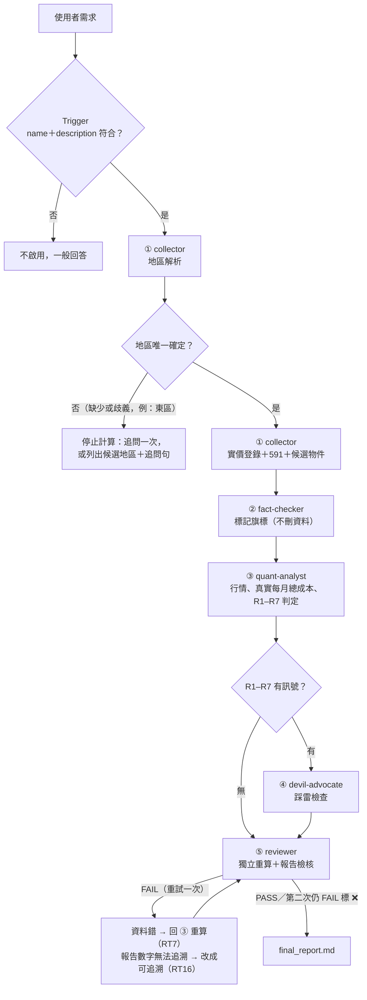

# student-rental-check：台灣學生租屋行情與避雷 Skill

**先看流程：** 打開 [`demo/index.html`](demo/index.html)，這是用一次真實執行（逢甲兩間房，`test-logs/B-4`）重播的互動畫面。會先看到 Skill 被喚起，再出現五個角色的格子，跟著標出每個人做了什麼，最後展開報告。可按「重播這次執行」。把這個檔用瀏覽器打開即可；若這個 repo 開了 GitHub Pages，路徑是 `/week11/homework/team-XX-skill/demo/`。

**最快開始：** 把本資料夾複製成專案裡的 `.claude/skills/student-rental-check/`，裝好套件後，在專案目錄貼上下面這句就會自動啟動（不用打 Skill 名稱、不用斜線指令）：

```
我在逢甲附近找房，有兩間在猶豫：第一間是分租套房 7 坪，一個月 7,000，房東說要先匯訂金才能看房；第二間是雅房，一個月 5,500，管理費不知道。哪間比較划算？會不會踩雷？
```

看完報告先看開頭的「給你看的摘要」。只說「東區」這種會對到好幾個縣市的地名時，它會先問清楚再算。

## 你只要提供這些

- **地區（一定要）：** 縣市＋區（例如「桃園市龜山區」），或學校名稱（例如「逢甲」「長庚」）。
- **物件（有就寫，沒有也可只問行情）：** 月租、坪數、管理費、水電瓦斯網路、押金、通勤時間，或直接貼 591 網址／刊登內容。
- 沒寫的項目會標「未提供」，不會幫你猜數字。

報告寫在你執行時的資料夾：`output/<時間>/final_report.md`。

## 安裝

在你要提問的專案目錄執行：

```bash
mkdir -p .claude/skills
cp -R /path/to/team-XX-skill .claude/skills/student-rental-check
pip install pandas numpy matplotlib requests
```

還需要 `node`（用來解析 591 頁面）。中文圖表需要中文字型（例如 Noto Sans CJK、文泉驛正黑），沒有時圖表會改英文標籤。離線時會自動改用 `sample-data/`（只涵蓋龜山、林口、西屯）。實價登錄 zip 會快取在 `data/lvr-cache/`。

另一個可直接複製的提示詞（單一物件、問貴不貴）：

```
我是長庚大學新生，在龜山區找到一間獨立套房，月租 9,500 元、權狀 8 坪，管理費另計 800 元，電費每度 5 元，騎車到學校單程約 12 分鐘。這個價格合不合理？真實每月要花多少？
```

## 五個角色會產出什麼

角色分工沒有改，只是把產出改成比較好懂的說法：

| 角色 | 做什麼 | 你會看到 |
| --- | --- | --- |
| ① collector 蒐集員 | 找出地區、取得實價登錄與 591、整理你說的物件 | 地區確認、物件表（`01_*`） |
| ② fact-checker 時效驗證員 | 標記過時、重複、來源不明、沒寫的費用（不刪資料） | 資料品質標記（`02_*`） |
| ③ quant-analyst CP 值精算師 | 算行情、真實每月總成本、排序、刊登價對照、高風險訊號 | 行情與成本、圖表（`03_*`、`charts/`） |
| ④ devil-advocate 踩雷獵人 | 只有出現高風險訊號才出場，挑戰排第一的物件 | 踩雷說明（`04_*`；沒訊號就略過） |
| ⑤ reviewer 審查員 | 從原始資料重新算一遍，寫成報告 | `final_report.md` |

流程：你的問題 → 自動啟動 → collector → fact-checker → quant-analyst →（有訊號才）devil-advocate → reviewer → `final_report.md`。詳細流程、路由表與例外見 `SKILL.md`。



自行驗證 `test-logs/` 的輸出複本：`python3 scripts/validate.py --input test-logs/A-1-output --evidence-copy`（複本刻意不含 `01_collected*.csv`、`03_inclusion_log.csv`）。

## 資料來源

- 內政部實價登錄「不動產租賃」批次資料：https://plvr.land.moi.gov.tw/DownloadOpenData（政府資料開放授權條款）。
- 591 租屋網刊登資料：只保存去識別化欄位，不存個資與原始網頁。取得流程參考 [Rent591Watcher](https://github.com/ryk001/Rent591Watcher)（該專案無授權條款，本 Skill 只參考流程、未複製程式碼）。
- 刊登租金≠成交價：兩者只並列比較，永不合併。
- 細節與驗證紀錄：`references/data-sources.md`；範例資料重建：`sample-data/HOW_TO_DOWNLOAD.md`。

## 測試

`tests/run_test.sh <ID> "<提示詞>" [max_turns]`：在乾淨暫存目錄安裝本 Skill，用 `claude -p --setting-sources project,local --output-format stream-json --verbose` 執行，log 去除絕對路徑後存到 `test-logs/`。A／B／C 測試結果、啟動證據與修正紀錄見 `test-report.md`。

11/18 為早期影片草稿錄製的 A、B 完整執行另存為 `test-logs/V-A.jsonl`、`V-B.jsonl`（含輸出複本 `V-A-output/`、`V-B-output/`），新版影片拿來當完整流程證據；新版影片中即時執行的 A、B、C 存為 `test-logs/LIVE-A.jsonl`、`LIVE-B.jsonl`、`LIVE-C.jsonl`（見 `test-report.md` 第 4.8 節）。V-A 審查 V8 FAIL 的除錯與修正後的回歸測試 A-5 見 `test-report.md` 第 4.6 節。

## 影片與 AI Tutor

- 影片已上傳 YouTube（不公開）：https://youtu.be/pKZa5sm2O5o （5:43，精確 5:43.67，edge-tts Yunjian 旁白＋燒錄字幕；公開 repo 不保留 mp4）。測試 A、B、C 以 `claude -p` 即時執行，A、B 限制回合數；測試 A 另展示完整 log 證據，測試 B 的完整多角色流程以互動畫面重播。章節表 `tutor/chapters.md`，字幕 `tutor/subtitles.zh-TW.srt`（95 段）。
- 影片與字幕 Drive 備份：https://drive.google.com/file/d/1CJLdnihYP16584XdWuF-ryBQE3Lkod-A/view?usp=sharing 、https://drive.google.com/file/d/1r63ynn51-j2KMkBb9tPanU19tTNps5v2/view?usp=sharing （知道連結的任何人可檢視）。
- AI Tutor（ClassTutor）材料在 `tutor/`：講義 `tutor-material.md`、詞彙 `vocabulary.txt`、課程簡介 `course-intro.md`；課程包 `tutor/student-rental-check_v8.classtutor`；雲端硬碟連結（知道連結的任何人可檢視）見 `submission.md`：https://drive.google.com/file/d/1QgwV-tgN19m_y3_yUeV_NSTXo7wgndOw/view?usp=sharing 。老師端製作與學生端使用步驟見 `tutor/README.md`。AI Tutor 已用 v8 課程包實測 2 題，結果見 `tutor/README.md` 第三節與 `submission.md`。

## 限制

- 實價登錄只含已申報案件；社會住宅比例因地區而異；坪數為登記面積（含公設）。
- 591 為刊登價，坪數為使用坪數，與實價登錄每坪租金不可直接比較。
- 物件事實沒寫就標「未提供」，不補預設值；所以「真實每月總成本」只代表已知項目。
- 時間價值（基本工資時薪）與電費每度上限未能取得官方原文，標「未驗證」；R5 暫停判定。
- 學校查表只收錄少數學校，其他學校請直接給縣市＋區。
