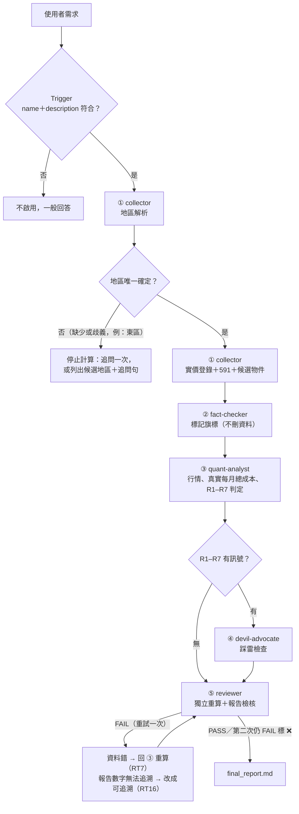

# student-rental-check：台灣學生租屋行情與避雷 Skill

學生指定地區（縣市＋區、學校名稱或地址）與候選物件，Skill 用內政部實價登錄租賃資料算行情、用 591 刊登資料補物件細節與刊登價對照，算出「真實每月總成本」（已知項目合計＋未提供項目），有風險才啟用踩雷檢查，最後由審查員從原始資料獨立重算抽查，產出 `final_report.md`（含看房殺價話術）。

## 五個角色

| 角色 | 只負責 | 產出 |
| --- | --- | --- |
| ① collector 蒐集員 | 地區解析、實價登錄與 591 取得、候選物件整理 | `01_*` |
| ② fact-checker 時效驗證員 | 標記過時、重複、來源不明、未提供（不刪資料） | `02_*` |
| ③ quant-analyst CP 值精算師 | 行情統計、真實每月總成本、排序、刊登租金對照、高風險訊號 | `03_*`、`charts/` |
| ④ devil-advocate 踩雷獵人 | 只在 R1–R7 成立時啟用，挑戰排名第一的物件 | `04_*` |
| ⑤ reviewer 審查員 | 獨立重算 V1–V13、組成最終報告 | `05_review_log.json`、`final_report.md` |

流程：使用者需求 → Trigger（SKILL.md 的 name＋description）→ collector → fact-checker → quant-analyst →（有訊號）devil-advocate → reviewer（品質檢查）→ `final_report.md`。詳細流程、路由表與例外見 `SKILL.md`。

## 安裝與啟動

1. 把本資料夾複製到專案的 `.claude/skills/student-rental-check/`（Claude Code）。
2. 環境：Python 3.10+，`pip install pandas numpy matplotlib requests`；需要 `node`（解析 591 頁面）；中文圖表需要中文字型（例：Noto Sans CJK、文泉驛正黑），沒有時圖表改英文標籤。
3. 直接用自然語言提問即可自動啟動，例如：「我在逢甲附近找房，有兩間在猶豫……哪間比較划算？會不會踩雷？」
4. 輸出在工作目錄的 `output/<run_id>/`。實價登錄 zip 會快取在 `data/lvr-cache/`。

離線時會自動改用 `sample-data/`（只涵蓋龜山、林口、西屯）。

自行驗證 `test-logs/` 的輸出複本：`python3 scripts/validate.py --input test-logs/A-1-output --evidence-copy`（複本刻意不含 `01_collected*.csv`、`03_inclusion_log.csv`）。

## 資料來源

- 內政部實價登錄「不動產租賃」批次資料：https://plvr.land.moi.gov.tw/DownloadOpenData（政府資料開放授權條款）。
- 591 租屋網刊登資料：只保存去識別化欄位，不存個資與原始網頁。取得流程參考 [Rent591Watcher](https://github.com/ryk001/Rent591Watcher)（該專案無授權條款，本 Skill 只參考流程、未複製程式碼）。
- 刊登租金≠成交價：兩者只並列比較，永不合併。
- 細節與驗證紀錄：`references/data-sources.md`；範例資料重建：`sample-data/HOW_TO_DOWNLOAD.md`。

## 測試

`tests/run_test.sh <ID> "<提示詞>" [max_turns]`：在乾淨暫存目錄安裝本 Skill，用 `claude -p --setting-sources project,local --output-format stream-json --verbose` 執行，log 去除絕對路徑後存到 `test-logs/`。A／B／C 測試結果、啟動證據與修正紀錄見 `test-report.md`。

11/18 為早期影片草稿錄製的 A、B 完整執行另存為 `test-logs/V-A.jsonl`、`V-B.jsonl`（含輸出複本 `V-A-output/`、`V-B-output/`），新版影片拿來當完整流程證據；新版影片中即時執行的 A、B、C 存為 `test-logs/LIVE-A.jsonl`、`LIVE-B.jsonl`、`LIVE-C.jsonl`（見 `test-report.md` 第 4.8 節）。V-A 審查 V8 FAIL 的除錯與修正後的回歸測試 A-5 見 `test-report.md` 第 4.6 節。

## 影片與 AI Tutor

- 影片 `../video/student-rental-check_final.mp4`（4:45，Google TTS 旁白＋燒錄字幕；測試 A、B、C 以 `claude -p` 即時執行，A、B 限制回合數，完整流程用 V-A／V-B 紀錄與離線執行角色腳本呈現）：章節表 `tutor/chapters.md`，字幕 `tutor/subtitles.zh-TW.srt`（上傳 YouTube 時一併上傳）。
- AI Tutor（ClassTutor）材料在 `tutor/`：講義 `tutor-material.md`、詞彙 `vocabulary.txt`、課程簡介 `course-intro.md`；課程包 `tutor/student-rental-check.classtutor`；老師端製作與學生端使用步驟、Q1–Q3 實測結果見 `tutor/README.md`。YouTube：https://youtu.be/HTNxGOs2UcE （不公開）。雲端硬碟連結見 `submission.md`。

## 限制

- 實價登錄只含已申報案件；社會住宅比例因地區而異；坪數為登記面積（含公設）。
- 591 為刊登價，坪數為使用坪數，與實價登錄每坪租金不可直接比較。
- 物件事實沒寫就標「未提供」，不補預設值；所以「真實每月總成本」只代表已知項目。
- 時間價值（基本工資時薪）與電費每度上限未能取得官方原文，標「未驗證」；R5 暫停判定。
- 學校查表只收錄少數學校，其他學校請直接給縣市＋區。
