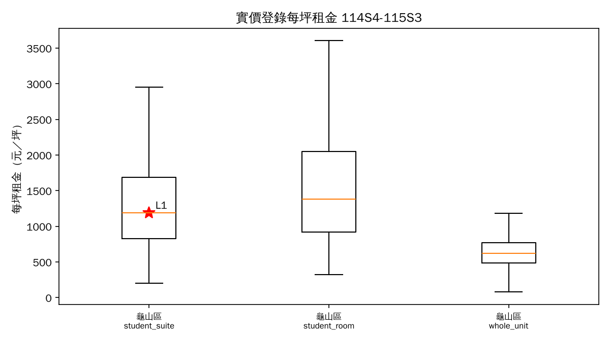
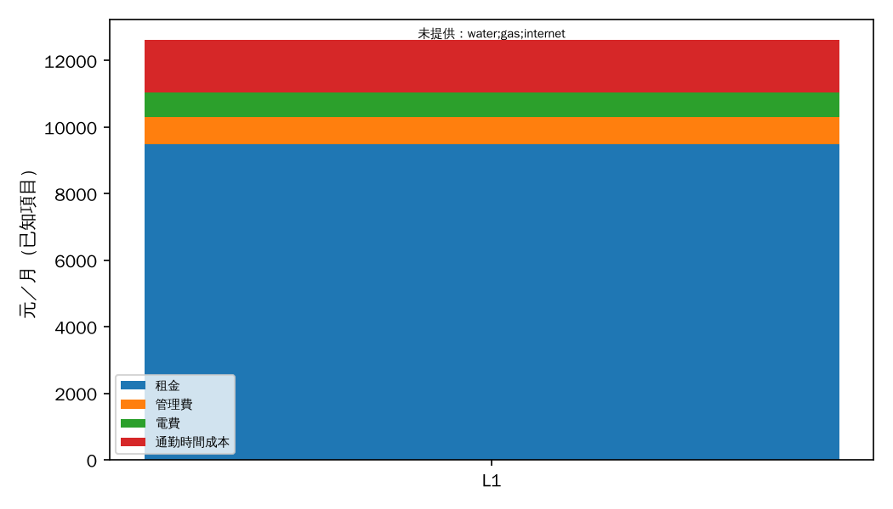

本次分析地區：桃園市龜山區（來源：使用者指定）　｜　run：20261118-220902

# 學生租屋行情與避雷報告

## 1. 一句話結論

這間龜山獨立套房每坪 1187.5 元，落在實價登錄龜山套房行情（含社宅）的第 49.9 百分位、與中位數差 -0.1%，價格合理；真實每月總成本為已知項目合計 12618 元＋未提供：水費、瓦斯、網路；未偵測到高風險訊號（R1–R7）。

## 2. 你問的問題、分析地區與模式

- 你的問題：長庚大學新生，龜山區獨立套房月租 9500 元、權狀 8 坪、管理費另計 800 元、電費每度 5 元、騎車單程 12 分鐘、刊登於學校租屋網；想用實價登錄判斷價格是否合理並算出真實每月總成本。
- 分析地區：桃園市|龜山區（user_explicit）；通勤目的地：長庚大學（學校查表）
- 模式：single；候選物件 1 間
- 資料：實價登錄 114S4、115S1、115S2、115S3（另以 112S4 做兩年前對照；online）；591 刊登使用快照（2026-11-18T17:26:16+08:00）

## 3. 行情摘要

| 分組 | 含社宅 | n | 退回 | 月租中位數 | 每坪 Q1／中位數／Q3 | P10 | 上界 |
| --- | --- | --- | --- | --- | --- | --- | --- |
| 桃園市\|龜山區\|student_suite\|114S4-115S3 | True | 1126 | — | 10000.0 | 824.8／1188.5／1687.0 | 660.5 | 2980.4 |
| 桃園市\|龜山區\|student_suite\|114S4-115S3 | False | 699 | — | 11500.0 | 1220.1／1583.3／2076.4 | 841.6 | 3360.8 |
| 桃園市\|龜山區\|student_room\|114S4-115S3 | True | 27 | — | 8275.0 | 921.8／1381.5／2048.5 | 654.6 | 3738.6 |
| 桃園市\|龜山區\|student_room\|114S4-115S3 | False | 27 | — | 8275.0 | 921.8／1381.5／2048.5 | 654.6 | 3738.6 |
| 桃園市\|龜山區\|whole_unit\|114S4-115S3 | True | 2402 | — | 19900.0 | 487.9／618.2／768.0 | 385.1 | 1188.2 |
| 桃園市\|龜山區\|whole_unit\|114S4-115S3 | False | 467 | — | 26000.0 | 733.8／845.1／992.9 | 625.1 | 1381.6 |

社宅敏感度：龜山套房含社宅時每坪中位數 1188.5 元、月租中位數 10000.0 元；排除社宅後每坪中位數 1583.3 元、月租中位數 11500.0 元。這間每坪 1187.5 元，若只和非社宅套房比，介於 P10（841.6）與 Q1（1220.1）之間，屬於偏便宜的一側。

### 3.1 591 刊登租金對照（刊登價≠成交價，未與實價登錄合併）

| 地區 | 類型 | 刊登筆數 | 刊登月租中位數 | 實價登錄月租中位數 | 刊登比實價登錄高 |
| --- | --- | --- | --- | --- | --- |
| 桃園市\|龜山區 | student_suite | 165 | 12000.0 | 10000.0 | 20.0% |
| 桃園市\|龜山區 | student_room | 16 | 6500.0 | 8275.0 | -21.5% |
| 桃園市\|龜山區 | whole_unit | 591 | 27000.0 | 19900.0 | 35.7% |

註：591 坪數為使用坪數，實價登錄為登記坪數（含公設），兩者每坪租金不可直接比較。

## 4. 候選物件真實每月總成本

| 物件 | 月租（基準） | 管理費 | 電費 | 水費 | 瓦斯 | 網路 | 通勤時間成本 | 已知項目合計 | 未提供 | 每坪 | 行情百分位 |
| --- | --- | --- | --- | --- | --- | --- | --- | --- | --- | --- | --- |
| L1 龜山獨立套房 | 9500（user_stated） | 800 | 750（5 元/度 × 150 度，使用者情境參數） | 未提供 | 未提供 | 未提供 | 1568 | 12618 | water;gas;internet | 1187.5 | 49.9 |

- 已知項目合計 12618 元＋未提供：水費、瓦斯、網路（未當作 0）。
- 通勤時間成本 1568 元是把騎車單程 12 分鐘、每月 20 天，以時薪 196 元換算的時間價值，不是現金支出；時薪參數為「未驗證」。
- 電費 750 元以每月 150 度（假設）估算，實際依你的用電量而定。
- 押金月數未提供；含成本後每坪 1577.2 元。

排名：single 模式，僅 1 間，不排名。

## 5. 風險提醒

未偵測到高風險訊號（R1–R7），因此未啟動踩雷獵人。仍請注意：fact-checker 標記 STALE_LISTING（未提供刊登日期，無法確認是否仍在招租）與 COST_UNSTATED（水費、瓦斯、網路、押金未提供）。

未能判定：
- L1 的 R5 不判定：電費上限未驗證（電價 5 元/度）
- R7 不判定：使用者沒有提供評論，此地區無評論資料

## 6. 資料限制

- 實價登錄只含已申報的租賃案件，並非全部成交；申請租金補貼者較常登錄。
- 社會住宅相關案件比例：桃園市|龜山區 目前行情窗內社會住宅相關案件 2362/3700 筆，需做排除社宅的敏感度比較（見第 3 節）。
- 實價登錄坪數為登記面積（含公設），每坪租金不等於室內坪數的租金；你提供的是權狀 8 坪，與實價登錄同基準。
- 管理費解析：見 01_collected.csv（行情資料中管理費未知的列標 MGMT_FEE_UNKNOWN，共 1670 列）。
- 樣本不足的退回：無。
- 591 為刊登租金，可能高於成交價，也可能已下架。
- 未驗證項目：hourly_value（時薪 196 元，勞動部公告原文未能取得）、elec_cap_per_kwh（電費上限，台電電價表未能取得，因此 R5 暫停判定）。
- 本 Skill 不使用模擬資料；評論只採用使用者提供的內容（本次：無）。

## 7. 假設參數表

| 參數 | 值 | 類別 | 狀態 | 來源 |
| --- | --- | --- | --- | --- |
| kwh_per_month | 150 度／月 | 使用者情境參數 | 假設 | 套房含冷氣的示意用量；使用者可改 |
| hourly_value | 196 元／小時 | 使用者情境參數 | 未驗證 | 以 2026 年基本工資時薪換算時間價值；勞動部公告原文未能於 2026-11-18 取得 |
| school_days_per_month | 20 天 | 使用者情境參數 | 假設 | 每週通學 5 天 |
| deposit_cap_months | 2 月 | 門檻 | 已查證 | 租賃住宅市場發展及管理條例第 7 條（2026-11-18 查證） |
| elec_cap_per_kwh | null | 門檻 | 未驗證 | 住宅租賃定型化契約應記載事項；台電電價表未能於 2026-11-18 取得 |
| stale_listing_days | 30 天 | 門檻 | 假設 | 規格書 9.2 |
| neg_review_min | 2 則 | 門檻 | 假設 | 規格書 9.2 |

物件事實（管理費、水電瓦斯網路、押金、通勤分鐘）沒有預設值：未提供就不計入。

## 8. 審查紀錄

| 檢核 | 結果 | 說明 |
| --- | --- | --- |
| V1 筆數與地區 | ✅ | 各季筆數與 area_source、city_code 一致 |
| V2 抽樣列重算 | ✅ | 5 筆坪數、日期、每坪租金一致 |
| V3 房屋類對帳 | ✅ | 4446/4446 |
| V4 分組統計 | ✅ | 6 組 n、中位數、Q1、Q3 一致 |
| V5 真實成本 | ✅ | L1 重算 12618 |
| V7 筆數守恆 | ✅ | 3588+912；rows_deleted=0 |
| V8–V11 報告數字追溯與格式 | ✅ | 報告階段檢核 |
| V12 訊號與踩雷報告一致 | ✅ | 無訊號、無 04 報告 |
| V13 刊登租金未混入行情 | ✅ | 0 |

審查結論：PASS；重試次數：0。

## 9. 附錄：看房殺價話術

1. 「這間每坪 1187.5 元，在實價登錄行情的第 49.9 百分位，價格算合理；想確認還有哪些費用另計？」
2. 「這區 591 刊登月租中位數 12000.0 元，實價登錄是 10000.0 元，刊登價通常還有議價空間。」
3. 「管理費是否已含在租金？電費每度怎麼算、有沒有獨立電錶？水費、瓦斯、網路是另計還是包含？」
4. 「押金是幾個月？可以報稅、入籍、申請租金補貼嗎？有書面契約與收據嗎？」
5. 「如果我簽一年、或一次付清幾個月，租金或管理費可以調整嗎？」
