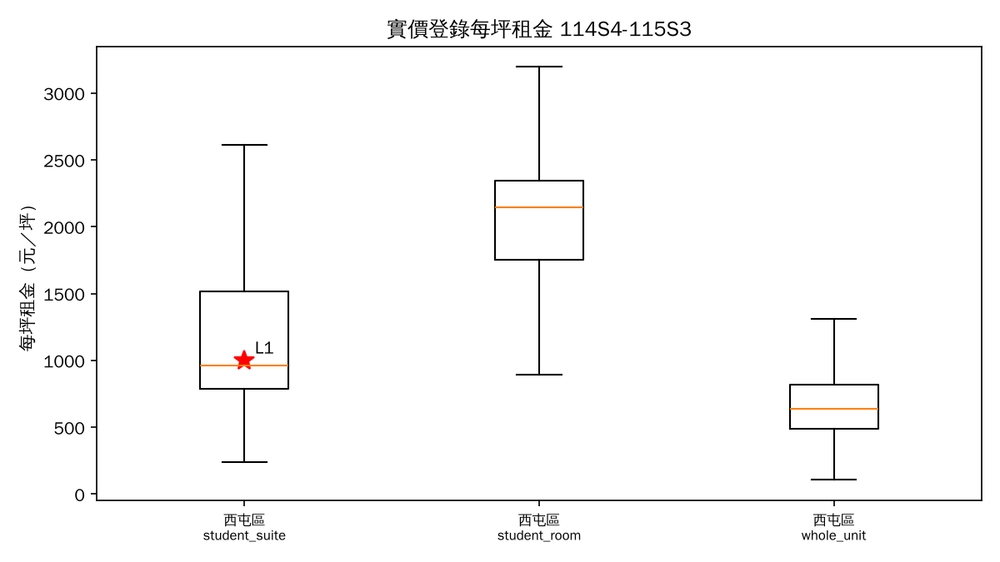
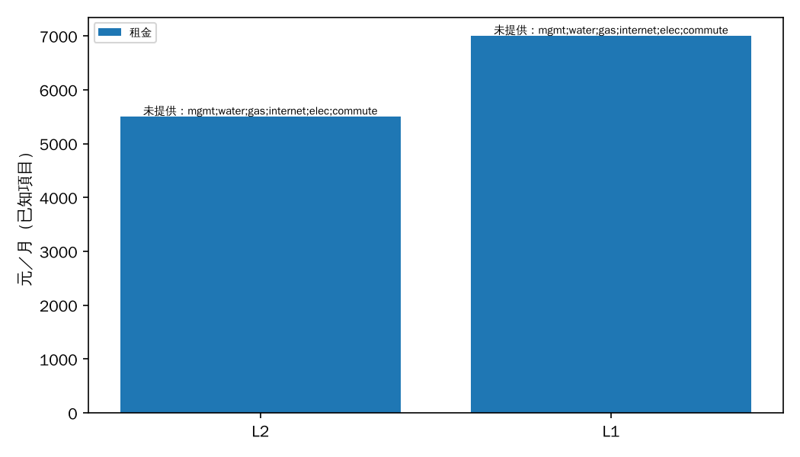

本次分析地區：臺中市西屯區（來源：學校查表）　｜　run：20261118-220902

# 學生租屋行情與避雷報告

## 1. 一句話結論

已知項目合計 L2 雅房 5500 元較低（比 L1 少 1500 元），L1 套房每坪 1000.0 元在行情第 55.2 百分位、價格合理，但 L1「先匯訂金才能看房」是高風險訊號（R3），不先看房就不要付款；兩間的管理費、水電瓦斯網路、通勤都未提供，現在還不能斷定哪間真的比較划算。

## 2. 你問的問題、分析地區與模式

- 你的問題：逢甲附近兩間候選房——分租套房 7 坪月租 7000、房東要先匯訂金才能看房；雅房月租 5500、管理費不知道。哪間划算？會不會踩雷？
- 分析地區：臺中市|西屯區（school_lookup：逢甲 → 臺中市西屯區）；通勤目的地：逢甲大學（通勤分鐘未提供）
- 模式：compare；候選物件 2 間
- 資料：實價登錄 114S4、115S1、115S2、115S3（趨勢對照 112S4）（online）；591 刊登快照（臺中市_西屯區，快照時間 2026-11-18T17:41:45+08:00）

## 3. 行情摘要

| 分組 | 含社宅 | n | 退回 | 月租中位數 | 每坪 Q1／中位數／Q3 | P10 | 上界 |
| --- | --- | --- | --- | --- | --- | --- | --- |
| 西屯區 student_suite（套房） | True | 2091 | — | 8000.0 | 786.4／959.2／1516.6 | 701.3 | 2612.0 |
| 西屯區 student_suite（套房） | False | 896 | — | 10500.0 | 1184.8／1679.8／2223.3 | 796.3 | 3781.1 |
| 西屯區 student_room（雅房） | True | 53 | — | 6400.0 | 1754.8／2148.1／2342.1 | 1275.2 | 3223.0 |
| 西屯區 student_room（雅房） | False | 53 | — | 6400.0 | 1754.8／2148.1／2342.1 | 1275.2 | 3223.0 |
| 西屯區 whole_unit（整層） | True | 1616 | — | 20000.0 | 488.3／635.6／817.0 | 401.4 | 1310.1 |
| 西屯區 whole_unit（整層） | False | 515 | — | 25800.0 | 667.8／882.0／1106.0 | 532.4 | 1763.2 |

註：西屯套房含社宅與不含社宅差距很大（月租中位數 8000.0 vs 10500.0），社宅包租價會拉低行情；若以不含社宅的分組看，L1 的每坪 1000.0 元更偏便宜。

### 3.1 591 刊登租金對照（刊登價≠成交價，未與實價登錄合併）

| 地區 | 類型 | 刊登筆數 | 刊登月租中位數 | 實價登錄月租中位數 | 刊登比實價登錄高 |
| --- | --- | --- | --- | --- | --- |
| 臺中市|西屯區 | student_suite | 1347 | 8999.0 | 8000.0 | 12.5% |
| 臺中市|西屯區 | student_room | 12 | 5750.0 | 6400.0 | -10.2% |
| 臺中市|西屯區 | whole_unit | 2484 | 28500.0 | 20000.0 | 42.5% |

註：591 坪數為使用坪數，實價登錄為登記坪數（含公設），兩者每坪租金不可直接比較。雅房刊登只有 12 筆，參考性低。

## 4. 候選物件真實每月總成本

| 物件 | 月租（基準） | 管理費 | 電費 | 水費 | 瓦斯 | 網路 | 通勤時間成本 | 已知項目合計 | 未提供 | 每坪 | 行情百分位 |
| --- | --- | --- | --- | --- | --- | --- | --- | --- | --- | --- | --- |
| L1 逢甲分租套房 | 7000（user_stated） | 未提供 | 未提供 | 未提供 | 未提供 | 未提供 | 未提供 | 已知項目合計 7000 元＋未提供：管理費、水、瓦斯、網路、電、通勤 | mgmt;water;gas;internet;elec;commute | 1000.0 | 55.2 |
| L2 逢甲雅房 | 5500（user_stated） | 未提供 | 未提供 | 未提供 | 未提供 | 未提供 | 未提供 | 已知項目合計 5500 元＋未提供：管理費、水、瓦斯、網路、電、通勤 | mgmt;water;gas;internet;elec;commute | 未提供（缺坪數） | 無法判定 |

排名（compare）：第 1 名 L2（已知項目合計 5500），第 2 名 L1（7000，差 1500）。兩間共同已知項目只有「月租」，只用共同項目排名結果相同（rank_common_items：L2 第 1、L1 第 2）。注意：L1 是套房、L2 是雅房（通常衛浴共用），產品不同；且所有附加費用都未提供，差距可能被管理費或電費加價吃掉。

## 5. 風險提醒

**排名第一不等於可以租**：L2 便宜只是因為目前只知道月租，管理費、水電都未提供；L1 則有「未看房先付款」的典型詐騙特徵。

### L1 逢甲分租套房（風險等級：high）— 建議避開

- R3：使用者描述：『房東說要先匯訂金才能看房』，命中關鍵字「先匯訂金」
- R6：未說明刊登來源與日期（STALE_LISTING＋UNKNOWN_SOURCE）
- 可能情況（最壞在前）：假房東詐騙，收訂金後失聯、房子不存在或不是他的；對方是二房東或代管想先鎖客；房東怕被放鳥（仍不能合理化未看房先付款）
- 必問：可以先看房再付訂金嗎（不行就不要租）？是屋主本人嗎，能出示權狀或建物登記謄本？若是二房東，有屋主書面同意轉租嗎？訂金開不開收據、退還條件？管理費、電費每度、網路、押金幾個月？
- 建議：除非同意先看房並能證明屋主身分，否則不要匯任何款項。

### L2 逢甲雅房（風險等級：high）— 看房前必問

- R6：未說明刊登來源與日期（STALE_LISTING＋UNKNOWN_SOURCE）
- 可能情況（最壞在前）：刊登已過期或資訊不完整，管理費、電費加價讓總成本變高；刊登者是仲介或二房東；物件正常只是資訊不全
- 必問：現在還能租嗎？刊登者身分？管理費多少？電費每度幾元、有無獨立電錶？雅房坪數、衛浴幾人共用？押金幾個月？
- 建議：先問清管理費與水電計價再比較總成本。

未能判定：
- L2 的 R1／R2 不判定：缺坪數或行情樣本不足
- R7 不判定：使用者沒有提供評論，此地區無評論資料
- R4 押金過高：兩間押金都未提供，未判定
- R5 電費每度過高：上限（elec_cap_per_kwh）未驗證，暫停判定

## 6. 資料限制

- 實價登錄只含已申報的租賃案件，並非全部成交；申請租金補貼者較常登錄。
- 社會住宅相關案件比例：臺中市|西屯區 目前行情窗內社會住宅相關案件 2296/4137 筆，需做排除社宅的敏感度比較（見第 3 節含／不含社宅兩列）。
- 實價登錄坪數為登記面積（含公設），每坪租金不等於室內坪數的租金。
- 管理費解析：見 01_collected.csv（行情資料中 MGMT_FEE_UNKNOWN 旗標 3087 筆）。
- 樣本不足的退回：無。
- 591 為刊登租金，可能高於成交價，也可能已下架。
- 未驗證項目：hourly_value（時間價值）、elec_cap_per_kwh（電費每度上限，R5 暫停判定）。
- 本 Skill 不使用模擬資料；評論只採用使用者提供的內容（本次：無）。

## 7. 假設參數表

| 參數 | 值 | 類別 | 狀態 | 來源 |
| --- | --- | --- | --- | --- |
| kwh_per_month | 150 度／月 | 使用者情境參數 | 假設 | 套房含冷氣的示意用量；只在物件有每度電價時使用 |
| hourly_value | 196 元／小時 | 使用者情境參數 | 未驗證 | 以 2026 年基本工資時薪換算；勞動部公告原文未能取得 |
| school_days_per_month | 20 天 | 使用者情境參數 | 假設 | 每週通學 5 天 |
| deposit_cap_months | 2 月 | 門檻 | 已查證 | 租賃住宅市場發展及管理條例第 7 條 |
| elec_cap_per_kwh | null 元／度 | 門檻 | 未驗證 | 住宅租賃定型化契約應記載事項；原文與台電電價表未能取得 |
| stale_listing_days | 30 天 | 門檻 | 假設 | 規格書 9.2 |
| neg_review_min | 2 則 | 門檻 | 假設 | 規格書 9.2 |

物件事實（管理費、水電瓦斯網路、押金、通勤分鐘）沒有預設值：未提供就不計入。

## 8. 審查紀錄

| 檢核 | 結果 | 說明 |
| --- | --- | --- |
| V1 筆數與地區 | ✅ | 各季筆數、area_source、city_code 一致 |
| V2 抽樣列重算 | ✅ | 5 筆坪數、日期、每坪租金一致 |
| V3 房屋類對帳 | ✅ | 4729/4729 |
| V4 分組統計 | ✅ | 6 組 n、中位數、Q1、Q3 一致 |
| V5 候選成本 | ✅ | L1 7000、L2 5500 |
| V6 排名 | ✅ | 依已知項目合計遞增 |
| V7 筆數守恆 | ✅ | 3800+982；rows_deleted=0 |
| V12 訊號與踩雷報告 | ✅ | 有訊號且有 04_risk_report.json |
| V13 刊登租金未混入行情 | ✅ | 0 筆 |

審查結論：PASS；重試次數：0。

## 9. 附錄：看房殺價話術

1. （L1，有高風險訊號，取代議價語氣）「可以先看房、確認屋況與產權後再付訂金嗎？」
2. （L1）「這間每坪 1000.0 元，在實價登錄行情的第 55.2 百分位，價格算合理；想確認還有哪些費用另計？」
3. （L2，缺坪數，改用不含數字版本）「這區 591 雅房刊登月租中位數 5750.0 元，實價登錄是 6400.0 元，想確認 5500 是否含管理費？」
4. （兩間都問）「管理費是否已含在租金？電費每度怎麼算、有沒有獨立電錶？水費、瓦斯、網路是另計還是包含？」
5. 「押金是幾個月？可以報稅、入籍、申請租金補貼嗎？有書面契約與收據嗎？」
6. 「如果我簽一年、或一次付清幾個月，租金或管理費可以調整嗎？」
