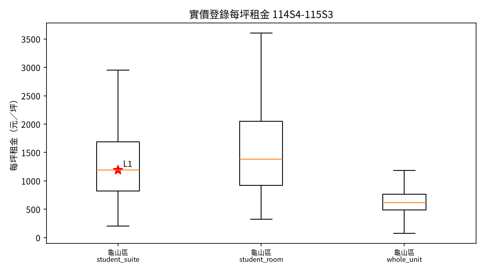
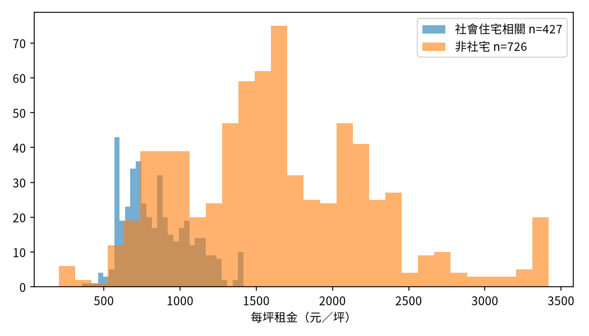
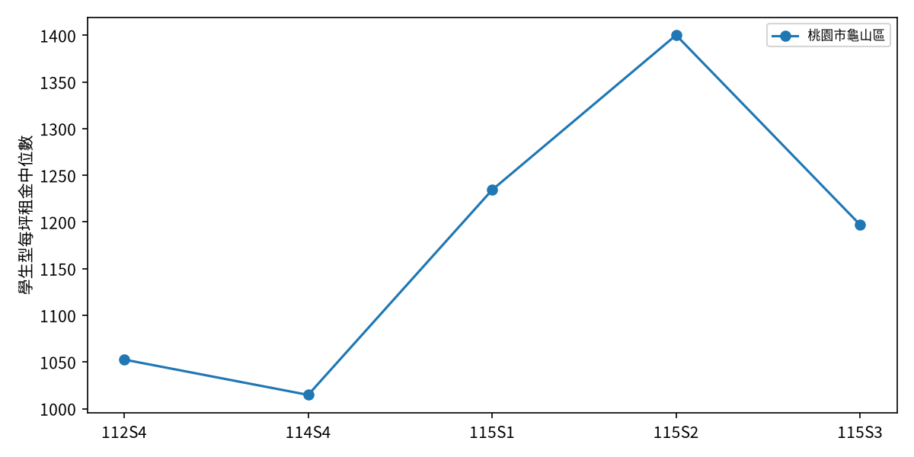
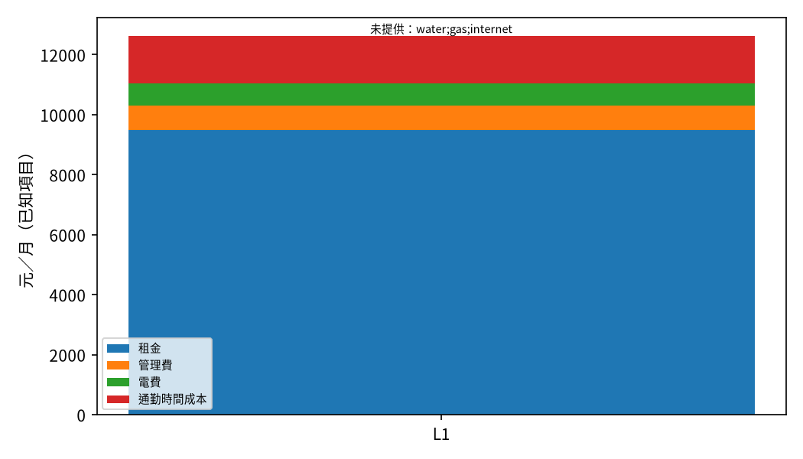

本次分析地區：桃園市龜山區（來源：使用者指定）　｜　run：20261118-233348

# 學生租屋行情與避雷報告

## 1. 一句話結論

這間獨立套房每坪 1187.5 元，落在龜山套房實價登錄行情（含社宅）的第 49.9 百分位、幾乎等於中位數 1188.5 元，價格合理；若排除社宅，則低於不含社宅行情的 Q1（1220.1 元），算偏便宜。真實每月總成本為已知項目合計 12618 元＋未提供：水費、瓦斯、網路；未偵測到高風險訊號（R1–R7）。

## 2. 你問的問題、分析地區與模式

- 你的問題：長庚大學新生，龜山區獨立套房，月租 9500 元、權狀 8 坪、管理費另計 800 元、電費每度 5 元、騎車到校單程約 12 分鐘、刊登於學校租屋網；想用實價登錄判斷價格是否合理並算出真實每月總成本。
- 分析地區：桃園市|龜山區（user_explicit）；通勤目的地：長庚大學（學校查表）
- 模式：single；候選物件 1 間
- 資料：實價登錄 114S4、115S1、115S2、115S3（另以 112S4 做兩年前對照；online，官方下載）；591 刊登快照（crawled_at 2026-11-18T17:26:16+08:00，見 `591_sources.json`）

## 3. 行情摘要

資料來源：`03_market_stats.csv`（行情窗 114S4-115S3，每坪租金以登記坪數計）。

| 分組 | 含社宅 | n | 退回 | 月租中位數 | 每坪 Q1／中位數／Q3 | P10 | 上界 |
| --- | --- | --- | --- | --- | --- | --- | --- |
| 桃園市\|龜山區\|student_suite（套房，本物件比對分組） | True | 1126 | — | 10000.0 | 824.8／1188.5／1687.0 | 660.5 | 2980.4 |
| 桃園市\|龜山區\|student_suite（套房） | False | 699 | — | 11500.0 | 1220.1／1583.3／2076.4 | 841.6 | 3360.8 |
| 桃園市\|龜山區\|student_room（雅房） | True | 27 | — | 8275.0 | 921.8／1381.5／2048.5 | 654.6 | 3738.6 |
| 桃園市\|龜山區\|student_room（雅房） | False | 27 | — | 8275.0 | 921.8／1381.5／2048.5 | 654.6 | 3738.6 |
| 桃園市\|龜山區\|whole_unit（整層） | True | 2402 | — | 19900.0 | 487.9／618.2／768.0 | 385.1 | 1188.2 |
| 桃園市\|龜山區\|whole_unit（整層） | False | 467 | — | 26000.0 | 733.8／845.1／992.9 | 625.1 | 1381.6 |

社宅敏感度：龜山套房含社宅的每坪中位數 1188.5 元，不含社宅為 1583.3 元，差距明顯（社宅租金較低，會把整體行情拉低）。本物件每坪 1187.5 元：對照含社宅行情約在中位數；對照不含社宅（一般民間出租）行情則低於 Q1 1220.1 元。

### 3.1 591 刊登租金對照（刊登價≠成交價，未與實價登錄合併）

資料來源：`03_asking_stats.csv`。

| 地區 | 類型 | 刊登筆數 | 刊登月租中位數 | 實價登錄月租中位數 | 刊登比實價登錄高 |
| --- | --- | --- | --- | --- | --- |
| 桃園市\|龜山區 | student_suite | 165 | 12000.0 | 10000.0 | 20.0% |
| 桃園市\|龜山區 | student_room | 16 | 6500.0 | 8275.0 | -21.5% |
| 桃園市\|龜山區 | whole_unit | 591 | 27000.0 | 19900.0 | 35.7% |

註：591 坪數為使用坪數，實價登錄為登記坪數（含公設），兩者每坪租金不可直接比較。本物件月租 9500 元也低於 591 龜山套房刊登月租中位數 12000.0 元。

## 4. 候選物件真實每月總成本

資料來源：`03_cost_breakdown.csv`、`01_candidates.csv`。

| 物件 | 月租（基準） | 管理費 | 電費 | 水費 | 瓦斯 | 網路 | 通勤時間成本 | 已知項目合計 | 未提供 | 每坪 | 行情百分位 |
| --- | --- | --- | --- | --- | --- | --- | --- | --- | --- | --- | --- |
| L1 龜山獨立套房 | 9500（user_stated） | 800 | 750（5 元/度 × 150 度，使用者情境參數） | 未提供 | 未提供 | 未提供 | 1568 | 12618 | water;gas;internet | 1187.5 | 49.9 |

- 真實每月總成本：**已知項目合計 12618 元＋未提供：水費、瓦斯、網路**（未提供項目沒有計入，不代表是 0 元）。
- 通勤時間成本 1568 元是「時間價值」而非現金支出：依單程 12 分鐘、每月通學 20 天、時間價值每小時 196 元（未驗證）換算；騎車的油錢與停車費使用者未提供，沒有計入。
- 電費 750 元是依假設用量每月 150 度換算，實際用電（尤其夏季開冷氣）會改變這一項。
- 含管理費的每坪成本 true_cost_per_ping 為 1577.2 元；vs_median_pct 為 -0.1%。
- 押金月數未提供（法定上限為 2 個月，見第 7 節）。

排名（compare）：本次為 single 模式，只有 1 間，不排名。

## 5. 風險提醒

未偵測到高風險訊號（R1–R7），因此略過 devil-advocate 踩雷檢查（`00_routing.json.agents_skipped`：no_high_risk_signal）。

fact-checker 對 L1 的提醒旗標（`02_flags.csv`）：
- STALE_LISTING（warn）：沒有刊登日期，無法確認刊登是否仍有效，看房前請先確認物件仍在招租。
- COST_UNSTATED（info）：未提供 water、gas、internet。

未能判定：
- L1 的 R5 不判定：電費上限未驗證（電價 5 元/度）
- R7 不判定：使用者沒有提供評論，此地區無評論資料

## 6. 資料限制

- 實價登錄只含已申報的租賃案件，並非全部成交；申請租金補貼者較常登錄。
- 社會住宅相關案件比例：桃園市|龜山區 目前行情窗內社會住宅相關案件 2362/3700 筆，需做排除社宅的敏感度比較（見第 3 節含／不含社宅兩列）。
- 實價登錄坪數為登記面積（含公設），每坪租金不等於室內坪數的租金。
- 管理費解析（`03_mgmt_fee_status.csv`，桃園市|龜山區）：not_mentioned 2522 筆、extra 869 筆、included 701 筆、unknown 338 筆、landlord_pays 70 筆。
- 樣本不足的退回：無（本物件比對分組 n = 1126）。
- 591 為刊登租金，可能高於成交價，也可能已下架；本次使用快照（list 792 筆、detail 181 筆）。
- 未驗證項目：hourly_value（時間價值 196 元／小時，影響通勤時間成本）、elec_cap_per_kwh（電費上限未取得，因此 R5 暫停判定）。
- 本 Skill 不使用模擬資料；評論只採用使用者提供的內容（本次：無）。

## 7. 假設參數表

資料來源：`references/cost-params.json`。

| 參數 | 值 | 類別 | 狀態 | 來源 |
| --- | --- | --- | --- | --- |
| kwh_per_month | 150 度／月 | 使用者情境參數 | 假設 | 套房含冷氣的示意用量；使用者可改。只在物件有『每度 X 元』時用來換算月電費 |
| hourly_value | 196 元／小時 | 使用者情境參數 | 未驗證 | 以 2026 年基本工資時薪換算時間價值；勞動部公告原文未能於 2026-11-18 取得，請自行確認。敏感度分析另跑 0 |
| school_days_per_month | 20 天 | 使用者情境參數 | 假設 | 每週通學 5 天 |
| deposit_cap_months | 2 月 | 門檻 | 已查證 | 租賃住宅市場發展及管理條例 第 7 條（https://law.moj.gov.tw/LawClass/LawSingle.aspx?pcode=D0060125&flno=7，2026-11-18 查證） |
| elec_cap_per_kwh | null（未取得） | 門檻 | 未驗證 | 依住宅租賃定型化契約應記載事項，以台電夏月最高級距為上限；原文與台電電價表未能於 2026-11-18 取得，因此 R5 暫停判定 |
| stale_listing_days | 30 天 | 門檻 | 假設 | 規格書 9.2 |
| neg_review_min | 2 則 | 門檻 | 假設 | 規格書 9.2；只在使用者提供評論時使用 |

物件事實（管理費、水電瓦斯網路、押金、通勤分鐘）沒有預設值：未提供就不計入。

## 8. 審查紀錄

| 檢核 | 結果 | 說明 |
| --- | --- | --- |
| V1 筆數與地區 | ✅ | 各季龜山筆數 800／830／819／909／1142 重算一致；area_source、city_code 合法 |
| V2 抽樣列換算 | ✅ | 5 筆抽樣的坪數、日期、每坪租金重算一致 |
| V3 月租對帳 | ✅ | 目標區房屋類全部可對帳（筆數只記於 05_review_log.json，見下方說明） |
| V4 分組統計 | ✅ | 6 個分組的 n、中位數、Q1、Q3 重算一致 |
| V5 真實成本 | ✅ | L1 已知項目合計 12618 重算一致 |
| V7 納入＋排除＝總筆數 | ✅ | 02_factcheck_summary.json 的 rows_in 4500 筆全部歸入納入或排除（排除 n_excluded 912，見 03_market_stats.csv）；rows_deleted=0 |
| V12 訊號與踩雷報告一致 | ✅ | 無 R 訊號，也沒有 04_risk_report.json |
| V13 刊登租金未混入行情 | ✅ | 03_market_stats 只含實價登錄 |
| V8 報告數字可追溯 | ❌ | 第二次報告檢核仍 FAIL，見下方「審查未通過項目」 |
| V9–V11 報告檢核 | 見 05_review_log.json | 由 `recompute.py --stage report` 執行 |

審查結論：❌ FAIL（資料階段 V1–V13 全數 PASS；報告階段 V8 第二次仍未通過，依 RT8 照常出報告）；資料階段重試次數：0；報告階段重試次數：1。

審查未通過項目：V8 final_report.md 的數字：無法追溯：4446、4446、3588。第二次檢核時，報告正文的 V3、V7 已不再使用這些數字；仍被判無法追溯的，是本節依規定原文抄錄第一次問題（report_first_issues）時出現的同一組數字。這組數字是審查腳本的對帳筆數，只記錄在 05_review_log.json，不影響任何行情或成本數字。第一次未通過項目：V8 final_report.md 的數字：無法追溯：4446、4446、3588。修法：這三個數字是審查腳本的對帳筆數，只存在於 05_review_log.json，不在 03_*、02_*、01_candidates.csv、cost-params.json 中，因此 V3 改寫為不含數字的敘述；V7 改為引用 02_factcheck_summary.json 的 rows_in 與 03_market_stats.csv 的 n_excluded。資料重算本身沒有錯誤。

## 9. 附錄：看房殺價話術

1. 行情錨點（接近中位數）：「這間每坪 1187.5 元，在實價登錄行情的第 49.9 百分位，價格算合理；想確認還有哪些費用另計？」
2. 刊登租金對照：「這區 591 刊登月租中位數 12000.0 元，實價登錄是 10000.0 元，刊登價通常還有議價空間。」（本物件已低於兩者，議價空間有限，建議把重點放在費用與條件。）
3. 隱藏成本：「管理費是否已含在租金？電費每度怎麼算、有沒有獨立電錶？水費、瓦斯、網路是另計還是包含？」
4. 簽約條件：「押金是幾個月？可以報稅、入籍、申請租金補貼嗎？有書面契約與收據嗎？」
5. 讓步交換：「如果我簽一年、或一次付清幾個月，租金或管理費可以調整嗎？」
