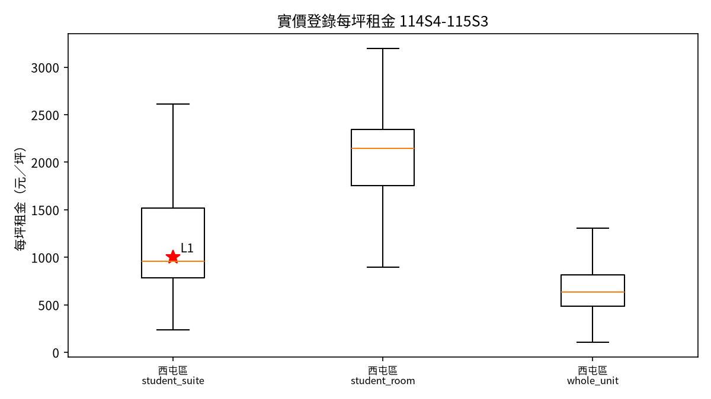
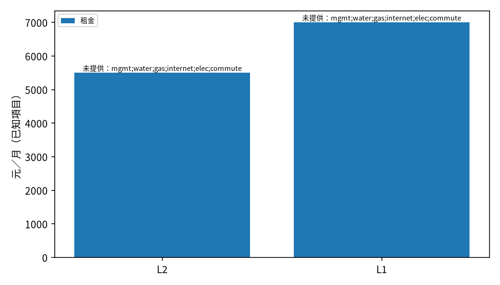

本次分析地區：臺中市西屯區（來源：學校查表）　｜　run：20261118-233629

# 學生租屋行情與避雷報告

## 1. 一句話結論

只看月租，L2 雅房（5500 元）比 L1 分租套房（7000 元）便宜 1500 元，L1 每坪 1000.0 元約在西屯套房行情第 55.2 百分位、價格不離譜；但 **L1 要求「先匯訂金才能看房」（R3），是常見詐騙手法，未看房前不要匯任何錢**，兩間也都沒交代刊登來源與日期（R6），且管理費、水電瓦斯網路全部未提供——排名第一不等於可以租。

## 2. 你問的問題、分析地區與模式

- 你的問題：逢甲附近兩間候選房（7 坪分租套房月租 7000、房東要求先匯訂金才能看房；雅房月租 5500、管理費不知道），哪間划算、會不會踩雷。
- 分析地區：臺中市|西屯區（school_lookup：逢甲 → 臺中市西屯區）；通勤目的地：逢甲大學（通勤分鐘未提供）
- 模式：compare；候選物件 2 間
- 資料：實價登錄 114S4、115S1、115S2、115S3（另以 112S4 做兩年前對照；online）；591 刊登快照（sample-data/591/臺中市_西屯區，快照時間 2026-11-18T17:41:45+08:00）

## 3. 行情摘要

| 分組 | 含社宅 | n | 退回 | 月租中位數 | 每坪 Q1／中位數／Q3 | P10 | 上界 |
| --- | --- | --- | --- | --- | --- | --- | --- |
| 臺中市\|西屯區\|student_suite（套房） | True | 2091 | — | 8000.0 | 786.4／959.2／1516.6 | 701.3 | 2612.0 |
| 臺中市\|西屯區\|student_suite（套房） | False | 896 | — | 10500.0 | 1184.8／1679.8／2223.3 | 796.3 | 3781.1 |
| 臺中市\|西屯區\|student_room（雅房） | True | 53 | — | 6400.0 | 1754.8／2148.1／2342.1 | 1275.2 | 3223.0 |
| 臺中市\|西屯區\|student_room（雅房） | False | 53 | — | 6400.0 | 1754.8／2148.1／2342.1 | 1275.2 | 3223.0 |
| 臺中市\|西屯區\|whole_unit（整層） | True | 1616 | — | 20000.0 | 488.3／635.6／817.0 | 401.4 | 1310.1 |
| 臺中市\|西屯區\|whole_unit（整層） | False | 515 | — | 25800.0 | 667.8／882.0／1106.0 | 532.4 | 1763.2 |

社宅敏感度：西屯套房含社宅的每坪中位數 959.2 元，排除社宅後是 1679.8 元，差很多。L1 每坪 1000.0 元在含社宅分組約第 55.2 百分位；若和排除社宅的一般套房比，還低於 Q1 1184.8 元。雅房月租中位數 6400.0 元、Q1 6000.0 元，L2 的 5500 元低於 Q1，但 L2 沒有坪數，無法用每坪租金判斷高低。

### 3.1 591 刊登租金對照（刊登價≠成交價，未與實價登錄合併）

| 地區 | 類型 | 刊登筆數 | 刊登月租中位數 | 實價登錄月租中位數 | 刊登比實價登錄高 |
| --- | --- | --- | --- | --- | --- |
| 臺中市\|西屯區 | student_suite | 1347 | 8999.0 | 8000.0 | 12.5% |
| 臺中市\|西屯區 | student_room | 12 | 5750.0 | 6400.0 | -10.2% |
| 臺中市\|西屯區 | whole_unit | 2484 | 28500.0 | 20000.0 | 42.5% |

註：591 坪數為使用坪數，實價登錄為登記坪數（含公設），兩者每坪租金不可直接比較。雅房刊登只有 12 筆，參考性低。

## 4. 候選物件真實每月總成本

| 物件 | 月租（基準） | 管理費 | 電費 | 水費 | 瓦斯 | 網路 | 通勤時間成本 | 已知項目合計 | 未提供 | 每坪 | 行情百分位 |
| --- | --- | --- | --- | --- | --- | --- | --- | --- | --- | --- | --- |
| L1 逢甲分租套房 | 7000（user_stated） | 未提供 | 未提供 | 未提供 | 未提供 | 未提供 | 未提供 | 7000 | mgmt;water;gas;internet;elec;commute | 1000.0 | 55.2 |
| L2 逢甲雅房 | 5500（user_stated） | 未提供 | 未提供 | 未提供 | 未提供 | 未提供 | 未提供 | 5500 | mgmt;water;gas;internet;elec;commute | 未提供（無坪數） | 無法判定 |

- L1：已知項目合計 7000 元＋未提供：管理費、水、電、瓦斯、網路、通勤。
- L2：已知項目合計 5500 元＋未提供：管理費、水、電、瓦斯、網路、通勤。

排名（依 03_ranking.csv）：第 1 名 L2（已知項目合計 5500）、第 2 名 L1（7000，差 1500）。兩間都只有「月租」這一項已知，共同項目排名（rank_common_items）同樣是 L2 第 1、L1 第 2。**這只是月租排名**：若 L2 的管理費加雜費比 L1 多出 1500 元以上，結果就會反轉。另外雅房通常共用衛浴，和套房的居住條件不同。

## 5. 風險提醒

> **排名第一不等於可以租**：L2 便宜 1500 元，但管理費與所有雜費都未提供；L1 要求未看房先匯訂金，是常見詐騙手法。

### L1 逢甲分租套房（風險等級：high｜建議避開）

- 訊號與證據
  - R3：使用者描述「房東說要先匯訂金才能看房」（命中關鍵字：先匯訂金）。
  - R6：02_flags.csv 同時有 UNKNOWN_SOURCE 與 STALE_LISTING（沒有說刊登來源與刊登日期）。
- 可能情況（最壞的在前）
  1. 假房東詐騙：用合理甚至偏低的價格當誘餌，收到訂金後失聯，房子可能不是對方的或根本不存在。
  2. 對方是二房東或代理人（「分租」可能代表承租人再轉租），沒有屋主同意書，入住後可能被屋主要求搬離。
  3. 真房東只是想用訂金篩人；即使如此，未看房先付款仍沒有任何保障。
- 必問
  - 可以先看房、確認屋況後再付訂金嗎？不行的話為什麼？
  - 你是屋主本人嗎？能否出示建物權狀並核對與簽約人一致？若是轉租，有屋主同意書嗎？
  - 訂金會開收據嗎？不租的話怎麼退？
  - 管理費、水、電（每度多少、有無獨立電錶）、瓦斯、網路是否另計？押金幾個月？
  - 可以報稅、入籍、申請租金補貼嗎？
- 建議：**建議避開**——在不能先看房的前提下不要匯任何款項；若對方同意先看房、確認身分並開收據，才改列「看房前必問」。

### L2 逢甲雅房（風險等級：high｜看房前必問）

- 訊號與證據
  - R6：02_flags.csv 同時有 UNKNOWN_SOURCE 與 STALE_LISTING（沒有說刊登來源與刊登日期）。
- 可能情況（最壞的在前）
  1. 刊登已過期或資訊不完整，管理費與雜費另計後總成本高於表面月租。
  2. 刊登者可能是仲介或二房東，條件與屋主認知不同。
  3. 只是資訊沒寫完整，問清楚後可能是正常物件。
- 必問
  - 這間現在還可以租嗎？你是屋主、代理人、仲介還是二房東？
  - 管理費多少？租金含哪些費用？
  - 電費每度怎麼算、有無獨立電錶？水、瓦斯、網路怎麼分攤？
  - 衛浴幾人共用？房間幾坪？押金幾個月？
  - 可以報稅、入籍、申請租金補貼嗎？
- 建議：**看房前必問**——先確認仍可租、刊登者身分與管理費和雜費。

註：R6 只要「沒說刊登來源＋沒說刊登日期」就會判 high，可能偏嚴；補上來源與日期後可重新評估。押金上限與轉租相關規定，請向主管機關或官方資料確認（租賃住宅市場發展及管理條例第 7 條；民法第 443 條）。

未能判定：
- L2 的 R1／R2 不判定：缺坪數或行情樣本不足
- R7 不判定：使用者沒有提供評論，此地區無評論資料
- R4（押金過高）：兩間都未提供押金，無法判定
- R5（電費每度過高）：電費上限 elec_cap_per_kwh 未驗證，暫停判定

## 6. 資料限制

- 實價登錄只含已申報的租賃案件，並非全部成交；申請租金補貼者較常登錄。
- 社會住宅相關案件比例：臺中市|西屯區 目前行情窗內社會住宅相關案件 2296/4137 筆，需做排除社宅的敏感度比較（見第 3 節，套房分組差異大）。
- 實價登錄坪數為登記面積（含公設），每坪租金不等於室內坪數的租金。
- 管理費解析（03_mgmt_fee_status.csv，臺中市|西屯區）：not_mentioned 4111 筆、included 427 筆、unknown 166 筆、extra 62 筆、landlord_pays 16 筆；多數成交案件沒寫管理費，行情月租不一定含管理費。
- 樣本不足的退回：無（各分組 n 皆 ≥ 10）。
- 591 為刊登租金，可能高於成交價，也可能已下架。
- 未驗證項目：hourly_value（時間價值，未驗證）、elec_cap_per_kwh（電費上限，未驗證，R5 暫停判定）。
- 本 Skill 不使用模擬資料；評論只採用使用者提供的內容（本次：無）。

## 7. 假設參數表

| 參數 | 值 | 類別 | 狀態 | 來源 |
| --- | --- | --- | --- | --- |
| kwh_per_month | 150 度／月 | 使用者情境參數 | 假設 | 套房含冷氣的示意用量；只在物件有「每度 X 元」時使用（本次未使用） |
| hourly_value | 196 元／小時 | 使用者情境參數 | 未驗證 | 以基本工資時薪換算；本次無通勤分鐘，未使用 |
| school_days_per_month | 20 天 | 使用者情境參數 | 假設 | 每週通學 5 天（本次未使用） |
| deposit_cap_months | 2 月 | 門檻 | 已查證 | 租賃住宅市場發展及管理條例第 7 條 |
| elec_cap_per_kwh | null | 門檻 | 未驗證 | 台電電價表未能取得，R5 暫停判定 |
| stale_listing_days | 30 天 | 門檻 | 假設 | 規格書 |
| neg_review_min | 2 則 | 門檻 | 假設 | 規格書；只在使用者提供評論時使用 |

物件事實（管理費、水電瓦斯網路、押金、通勤分鐘）沒有預設值：未提供就不計入。

## 8. 審查紀錄

| 檢核 | 結果 | 說明 |
| --- | --- | --- |
| V1 筆數與地區 | ✅ | 各季筆數、area_source、city_code 重算一致 |
| V2 抽樣原始列 | ✅ | 5 筆抽樣的坪數、日期、每坪租金一致 |
| V3 房屋類別篩選 | ✅ | 目標區房屋類一致 |
| V4 分組統計 | ✅ | 3 類 × 含／不含社宅共 6 組重算一致 |
| V5 成本拆解 | ✅ | L1、L2 一致 |
| V6 排名 | ✅ | 03_ranking.csv 一致 |
| V7 不刪資料 | ✅ | 01 筆數 = 納入 + 排除；rows_deleted = 0 |
| V12 訊號與踩雷報告對應 | ✅ | 有 R 訊號 ⇔ 04_risk_report.json |
| V13 刊登租金未混入行情 | ✅ | 03_market_stats 只含實價登錄 |
| V8–V11 報告檢核 | ✅ | recompute.py --stage report：30 項 PASS |

審查結論：PASS；資料階段重試次數：0；報告階段重試次數：0。

## 9. 附錄：看房殺價話術

1. （L1，有高風險訊號，先處理這句）「可以先看房、確認屋況與產權後再付訂金嗎？」
2. （L1 行情）「這間每坪 1000.0 元，在實價登錄行情的第 55.2 百分位，價格算合理；想確認還有哪些費用另計？」
3. （刊登對照）「這區 591 套房刊登月租中位數 8999.0 元，實價登錄是 8000.0 元，刊登價通常還有議價空間。」
4. （兩間都問，隱藏成本）「管理費是否已含在租金？電費每度怎麼算、有沒有獨立電錶？水費、瓦斯、網路是另計還是包含？」
5. （簽約條件）「押金是幾個月？可以報稅、入籍、申請租金補貼嗎？有書面契約與收據嗎？」
6. （讓步交換）「如果我簽一年、或一次付清幾個月，租金或管理費可以調整嗎？」
