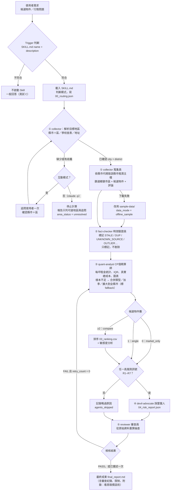

# 規格書：台灣各縣市學生租屋行情與避雷 Skill（student-rental-check）

| 項目 | 內容 |
| --- | --- |
| 文件版本 | v1.2（Skill 已依本版實作於 `homework/team-XX-skill/`；變更摘要見下方「v1.2 變更」） |
| 撰寫日期 | 2026-11-18（v1.1 同日修訂：範圍由「長庚周邊」擴大為台灣各縣市；v1.2 同日修訂：加入 591、取消物件事實的預設值、取消模擬資料） |
| 適用範圍 | 實價登錄有租賃資料的 21 個縣市、任一鄉鎮市區；使用者可用「縣市＋區」、學校名稱或地址指定地區（見 5.1.1）。長庚大學／龜山區只是範例之一 |
| Skill 名稱 | 維持 `student-rental-check`：名稱本來就不含地名，擴大範圍不需改名，也不必重做測試 log 的命名 |
| 對應作業 | 分組作業｜設計三角色 AI Skill（老師原文見 `teacher/三個角色的 AI Skill 作業.docx`） |
| 使用範本 | 老師提供之 `teacher/skill-template.zip`（SKILL.md、agents/、scripts/、references/、assets/） |
| 平台 | Claude Code（自動觸發與 log 證據以 Claude Code 為準） |
| 匿名 | 本文件不含組別、姓名、學號、帳號或絕對路徑；組員以「角色 A–D」代稱 |

### v1.2 變更（以本節為準，與後文衝突時依本節）

| # | 變更 | 影響章節 |
| --- | --- | --- |
| 1 | **以 Skill 為主體**：判斷與文字由 SKILL.md 與五個角色的指令文件負責；程式只留在「數字必須可重現、可獨立重算」之處，並合併為 8 支腳本（`resolve_area`、`collect_lvr`、`crawl_591`、`candidates`、`flag`、`analyze`、`recompute`、`validate`） | 3、5、12 |
| 2 | **591 租屋網為補充來源**：collector 以目標地區爬取 591 刊登（取得流程參考 Rent591Watcher，無授權條款、只註明出處不複製程式碼；請求間隔 1–3 秒、刊登頁每次最多 300 筆），也接受使用者給的 591 網址或貼上的刊登文字。原 1.4「不爬 591」刪除 | 1.4、5.1、6.5 |
| 3 | **刊登租金與實價登錄租金永不合併**：刊登租金另算 `03_asking_stats.csv` 並列比較；R1／R2 只用實價登錄；591 坪數為使用坪數，不比每坪百分位；reviewer 新增 **V13** | 4、5.3、5.5 |
| 4 | **不猜**：物件事實（管理費、電費每度、水費、瓦斯、網路、押金、通勤分鐘）沒寫就是「未提供」，取消 v1.1 的電費 5 元、管理費中位數、通勤 15／30 分鐘等預設。真實每月總成本改為「已知項目合計＋未提供清單」；缺項不同時排名標「不完全可比」並另以共同項目重排 | 9、5.3 |
| 5 | **使用者情境參數**（每月用電 150 度、時間價值 196 元／時、每月通學 20 天）保留為明示參數，報告列出值與查證狀態 | 9.2 |
| 6 | **隱藏成本拆成五項**：管理費、電費、水費、瓦斯、網路，各自記錄 stated／included／unstated | 5.1、9.1 |
| 7 | **不使用模擬資料**：取消 40 則模擬評論與模擬候選物件；R7 只在使用者提供評論時判斷；候選物件範例改用 591 去識別化快照 | 6.4、12 |
| 8 | **未驗證項目照實標示**：時間價值、電費上限（R5 暫停判定）、學校所在區等，報告第 6、7 節與最後回覆都列出 | 5.5、9.2 |
| 9 | **測試由兩個 agent 執行**：Agent 1 跑應啟動（A、B 與 591 加測），Agent 2 跑不應啟動（C、C2、C3 與 4 題近似題） | 13 |

---

## 1. 目的與使用情境

### 1.1 要解決的問題

台灣各地的大學生都要在學校周邊找房：例如長庚大學學生多在桃園市龜山區與新北市林口區找房，逢甲大學學生多在臺中市西屯區找房。不論哪個縣市，學生判斷「這間貴不貴、值不值得」時，常遇到三個相同的問題：

1. **行情無從比較**：591、FB 社團、學校租屋網的刊登價各說各話；官方實價登錄雖可查，但欄位多、單位是平方公尺、日期是民國年，學生不會清理。
2. **只看月租，忽略隱藏成本**：管理費是否另計、電費每度多少、通勤時間，常讓兩間月租相近的房子實際成本差很多。實價登錄的「備註」欄有大量管理費文字（例：「租金總額含管理費；」「管理費：2600元，由承租人負擔」），必須解析才能比較。
3. **踩雷訊號不易察覺**：先匯訂金才能看房、押金超過兩個月、價格低得不合理、不能報稅或入籍等，學生常在簽約後才發現。

公開討論可佐證這些痛點（引自 `topic-research.md`，該檔於 2026-11-18 研究時已開啟原頁）：

- Dcard〈中興大學租屋看房注意事項懶人包〉https://www.dcard.tw/f/nchu/p/238630083 ：「可以多觀察市價……就知道理想房間需要多少錢」；留言：「租客／學生真的很吃虧，租下去才知道回不去了」。
- PTT home-sale〈已經有租屋實價登錄？〉https://www.ptt.cc/bbs/home-sale/M.1723345067.A.C1F.html ：留言指出「現在上面會登記的基本都是要拿租補的才去登記」，以及「裝潢／家具／視野／有無包管理費會有落差」。這正是本 Skill 要處理的資料品質問題。

### 1.2 Skill 目標

做一個 Skill，讓學生指定目標地區（縣市＋區，或學校名稱、地址），輸入一間或多間候選房（或只問行情），由五個角色依序（部分有條件）完成：

> 確認目標地區並蒐集該區實價登錄租賃資料 → 時效與品質標記 → 行情統計與「真實每月總成本」精算 →（有風險才）踩雷檢查 → 審查員重算抽查並產出最終報告（附看房殺價話術）

### 1.3 使用情境（代表性需求）

| 情境 | 使用者說法範例 | 模式 |
| --- | --- | --- |
| 只問行情 | 「龜山長庚附近獨立套房現在一個月大概多少？」「台南東區雅房行情？」 | `market_only` |
| 單一物件判斷 | 「這間 8 坪套房月租 9,500、管理費 800 另計，貴不貴？」（另需地區，見 5.1.1） | `single` |
| 多物件比較 | 「逢甲附近兩間在猶豫，哪間比較划算？」「林口跟龜山各一間」（可跨區、跨縣市） | `compare` |
| 擔心踩雷 | 「房東說要先匯訂金才能看房，正常嗎？」 | 任一模式加上踩雷檢查 |

### 1.4 不做的事（範圍外）

- 不爬 Dcard、FB 等需登入的平台；591 只以目標地區少量、間隔請求取得刊登資料，且不保存個資與原始網頁（見 6.5）。
- 不提供法律意見；涉及法規只列「應向官方確認」的問題清單。
- 不處理買房、房貸、房價；不處理台灣以外的地區。
- 實價登錄沒有租賃檔的縣市（規格撰寫時檢查五季 zip，連江縣只有買賣檔、沒有 `z_lvr_land_c.csv`）只告知無資料，不硬算（見 E19）。
- 不呼叫地圖或地理編碼 API、不自行猜測地址屬於哪一區；地區一律依 5.1.1 的查表或使用者確認決定。
- 不輸出任何門牌地址（原始資料雖有部分遮蔽，仍一律刪除；見 8.3）。

---

## 2. 啟動／不啟動條件與 SKILL.md frontmatter 草稿

### 2.1 Skill 名稱

`student-rental-check`（kebab-case；資料夾名稱同此）

### 2.2 應啟動（Trigger）

同時滿足 **A 與 B**，或滿足 **C**：

- **A（主題）**：租屋（租金、房租、套房、雅房、分租、整層、房東、押金、訂金、管理費、電費每度、看房、簽約、續租）。
- **B（地點／身分）**：台灣任一縣市、鄉鎮市區、學校、捷運／火車站或地址（例：龜山、林口、長庚、西屯、逢甲、台南東區），或「學校附近」「宿舍抽不到要外宿」等學生找房語境；使用者自述為大學生、研究生、新生亦算。
- **C（明確指名）**：提到「實價登錄」＋「租賃／租金」（不論地區）。

即使沒說「實價登錄」「行情」或任何特定學校，只要是在台灣找學生租屋並問「貴不貴、划不划算、會不會踩雷、怎麼比」，就應啟動。訊息中沒有地點也應啟動，再由 collector 依 5.1.1 追問或停止，不在 Trigger 階段擋掉。

### 2.3 不應啟動

| 類型 | 範例 | 理由 |
| --- | --- | --- |
| 買賣／房貸 | 「林口預售屋現在一坪多少？」 | 屬買賣，不是租賃 |
| 台灣以外 | 「東京學生套房一個月多少？」 | 沒有對應的實價登錄資料 |
| 學校但與租屋無關 | 「長庚大學圖書館幾點關門？」 | 只有地點，沒有租屋主題 |
| 一般程式／數學 | 「幫我寫一個計算兩個日期相差幾天的 Python 函式」 | 與 Skill 無關 |
| 一般租屋法律問答，不需數據 | 「租屋押金法規上限是多少？」 | 可直接回答，不需跑資料流程（可附一句「若要比較你學校周邊的行情，可再提供地區與物件」） |

### 2.4 SKILL.md frontmatter 草稿（v1）

```yaml
---
name: student-rental-check
description: >
  台灣各縣市學生租屋行情與避雷檢查。使用者可用縣市與區、學校名稱
  或地址指定地區（例：龜山長庚附近、台中逢甲附近、台南東區）。
  當使用者想知道套房、雅房或整層的租金合不合理、貴不貴、划不划算，
  要比較多間候選房，計算含管理費、水電、通勤時間的真實每月成本，
  或擔心訂金、押金、二房東、價格異常等踩雷風險時使用；
  使用者貼上 591 刊登或網址請你看看時也使用。
  即使沒說「實價登錄」「行情」或縣市名稱，只要是在台灣找學生租屋、
  「學校附近」找房就應啟用。資料來源為內政部實價登錄租賃開放資料與 591 租屋網刊登。
  不要用於：買房、預售屋或房貸、台灣以外的租屋、與租屋無關的學校
  校務問題、一般程式或數學問題。
---
```

> 設計說明：依老師範本建議「寫得略為積極」，列出觸發詞與情境；同時明列「不要用於」，以支撐測試 C。description 須少於 1,024 字元。第 13.6 節規劃以這版為 v1，依測試結果修訂為 v2，並保留 diff 作為除錯證據。

---

## 3. 完整流程

### 3.1 流程總覽

使用者需求 → Trigger 判斷 → 載入 SKILL.md 並決定路由 → ① collector → ② fact-checker → ③ quant-analyst →（條件）④ devil-advocate → ⑤ reviewer（品質檢查）→ 最終成果 `final_report.md`

### 3.2 流程圖（含條件分支）



### 3.3 各階段產出（檔名皆在 `output/<run_id>/`）

| 階段 | 角色 | 主要產出 | 必定執行？ |
| --- | --- | --- | --- |
| 0 | SKILL.md 主流程 | `00_routing.json` | 是 |
| 1 | collector | `01_area.json`（地區解析結果）、`01_collected.csv`、`01_candidates.csv`、`01_reviews.csv`、`01_collect_manifest.json` | 是 |
| 2 | fact-checker | `02_flags.csv`、`02_factcheck_summary.json` | 是 |
| 3 | quant-analyst | `03_market_stats.csv`、`03_cost_breakdown.csv`、`03_ranking.csv`（compare 才有）、`charts/*.png` | 是 |
| 4 | devil-advocate | `04_risk_report.json`、`04_risk_report.md` | 有 R 訊號才執行 |
| 5 | reviewer | `05_review_log.json`、`final_report.md` | 是 |

`run_id` 格式：`YYYYMMDD-HHMMSS`（西元，台北時間）。

---

## 4. 路由規則表（Routing）

每條規則都能從 `00_routing.json`、輸出檔是否存在，以及 log 中 Read 了哪些 `agents/*.md` 來檢驗。

| 規則 ID | 判定條件（可程式判定） | 動作 | 可核對證據 |
| --- | --- | --- | --- |
| RT0 | 使用者訊息符合第 2.2 節 | 載入 Skill | log 中 `tool_use.name == "Skill"`，且 `input.skill == "student-rental-check"` |
| RT1 | 一律執行 | 標準路徑：collector → fact-checker → quant-analyst → reviewer | Read `agents/collector.md`、`fact-checker.md`、`quant-analyst.md`、`reviewer.md` |
| RT2 | 候選物件數 = 0（訊息中沒有可辨識的月租數字） | `mode = market_only`：quant 只做行情統計，不產 `03_cost_breakdown.csv` | `00_routing.json.mode` |
| RT3 | 候選物件數 = 1 | `mode = single`：行情 + 該物件真實總成本 + 百分位位置 | `03_cost_breakdown.csv` 有 1 列 |
| RT4 | 候選物件數 ≥ 2 | `mode = compare`：加做排序與敏感度分析 | `03_ranking.csv` 存在，列數 = 候選數 |
| RT5 | 任一候選物件出現 R1–R7（見 4.1） | 啟動 devil-advocate | Read `agents/devil-advocate.md`；`04_risk_report.json` 存在 |
| RT6 | 沒有任何 R 訊號 | 略過 devil-advocate | `00_routing.json.agents_skipped` 含 `{"agent":"devil-advocate","reason":"no_high_risk_signal"}`；log 中**沒有** Read `devil-advocate.md` |
| RT7 | reviewer `verdict = FAIL` 且 `retry_count = 0` | 退回 quant-analyst 重算一次 | `05_review_log.json.retry_count = 1` |
| RT8 | 第二次仍 FAIL | 照常輸出報告，但在「審查結果」節標 ❌ 並列出未通過項目，不得隱藏 | `final_report.md` 含「審查未通過項目」 |
| RT9 | 官方下載失敗（連線、TLS、HTTP 非 200，重試 3 次） | 改用 `sample-data/`，標記 `data_mode = offline_sample` | `01_collect_manifest.json.data_mode` |
| RT10 | 候選物件缺月租等必要欄位 | 互動模式：只追問一次；非互動模式（`claude -p`）：該物件降級為「不計算」，記錄原因後繼續 | `01_candidates.csv.status = incomplete` |
| RT11 | 使用者只要殺價話術 | 仍跑標準路徑（話術需要行情數字）；附錄一律產出 | `final_report.md` 附錄節 |
| RT12 | 目標地區可唯一確定（使用者給了縣市＋區，或學校／地址查表只有一個結果） | 照常執行；地區與其來源寫入 `00_routing.json.area` | `01_area.json.area_status = resolved` |
| RT13 | 目標地區缺少或有歧義（見 5.1.1、E16） | 互動模式：追問一次；非互動模式：不下載、不計算，由 SKILL.md 主流程直接寫追問版 `final_report.md`（只列可選地區與需要使用者補充的內容） | `01_area.json.area_status = unresolved`；`agents_skipped` 含 fact-checker、quant-analyst、devil-advocate、reviewer，`reason = area_unresolved` |
| RT14 | 目標區有效樣本 `n < min_group_n` | 依 5.3 的退回順序擴大（合併類型 → 加季 → 全縣市），每一步都標記 | `03_market_stats.csv.fallback` 非空；報告「資料限制」節說明 |
| RT15 | 有 591 資料（快照、即時爬取、網址或貼上） | 刊登租金另算 `03_asking_stats.csv`；候選物件來自 591 時標 `ASKING_PRICE`，月租照算成本但不比每坪百分位 | reviewer V13；`591_sources.json` |

### 4.1 高風險訊號定義（觸發 devil-advocate）

| 訊號 | 判定方式 | 門檻（參數） | 資料來源 |
| --- | --- | --- | --- |
| R1 價格過低 | 候選物件 `rent_per_ping` < 同群組 `lower_fence`，或低於 P10 | IQR 倍數 `iqr_k = 1.5` | `03_market_stats.csv` |
| R2 價格過高 | 候選物件 `rent_per_ping` > 同群組 `upper_fence` | 同上 | 同上 |
| R3 可疑話術／條件 | 候選 `notes_text` 或使用者訊息命中關鍵字：先匯訂金、先轉帳、未看房先付、不能看房、不給收據、不能報稅、不能入籍、不能申請租金補貼、頂樓加蓋、鐵皮、違建、二房東、轉租（未提同意書） | 關鍵字表放在 `references/risk-signals.md` | 使用者輸入 |
| R4 押金過高 | `deposit_months` > 2 | `deposit_cap_months = 2`（依《租賃住宅市場發展及管理條例》押金上限，實作時由 collector 以全國法規資料庫原文查證並記錄條號） | 使用者輸入 |
| R5 電費每度過高 | `elec_price_per_kwh` > `elec_cap_per_kwh` | 上限值待查證（依住宅租賃定型化契約相關規定，以台電夏月最高級距為上限；實作時查證後填入參數檔並註明來源與日期） | 使用者輸入 |
| R6 來源可疑 | fact-checker 對該候選物件標記 `UNKNOWN_SOURCE` 且 `STALE_LISTING`，或 `severity=warn` 以上的旗標 ≥ 2 個 | — | `02_flags.csv` |
| R7 評論負面集中 | 同一地區（`area_key` = `縣市|鄉鎮市區`）的評論中，負面關鍵字（漏水、壁癌、隔音差、蟑螂、押金不退、房東擅自進入）命中 ≥ 2 則 | `neg_review_min = 2` | `01_reviews.csv` |

> 「管理費未知」「無電梯」等屬一般提醒，**不單獨觸發** devil-advocate，由 quant-analyst 在報告中以假設值處理並註明。

### 4.2 `00_routing.json` 範例

```json
{
  "run_id": "20261118-153000",
  "skill": "student-rental-check",
  "mode": "compare",
  "area": {
    "area_status": "resolved",
    "targets": [
      {"city": "臺中市", "city_code": "b", "district": "西屯區",
       "area_key": "臺中市|西屯區", "area_source": "school_lookup",
       "matched_text": "逢甲", "lookup_row": "逢甲大學"}
    ],
    "destination": {"label": "逢甲大學", "city": "臺中市", "district": "西屯區", "source": "school_lookup"}
  },
  "candidate_count": 2,
  "signals": [{"listing_id": "L1", "signal": "R3", "evidence": "訊息含「先匯訂金」"}],
  "agents_planned": ["collector", "fact-checker", "quant-analyst", "devil-advocate", "reviewer"],
  "agents_skipped": [],
  "data_mode": "online",
  "params_file": "references/cost-params.json",
  "warnings": []
}
```

`area_source` 只能是：`user_explicit`（使用者直接寫縣市＋區）、`user_confirmed`（互動模式追問後確認）、`school_lookup`（`references/school-districts.csv` 唯一命中）、`address_parse`（地址字串中解析出縣市＋區，且在 `references/districts.csv` 中存在）。沒有 `guess` 這個值。

---

## 5. 角色規格

所有角色都遵守：只做自己那一類工作；以檔案交接；每次交接附一份 5.6 節的「交接信封」JSON。

### 5.1 ① collector 蒐集員（`agents/collector.md`）

| 項目 | 內容 |
| --- | --- |
| 輸入 | 使用者訊息；`references/data-sources.md`（下載網址與季別）；`references/county-codes.csv`（縣市代碼，6.1.1）；`references/districts.csv`（各縣市鄉鎮市區名單）；`references/school-districts.csv`（學校→區）；`references/cost-params.json`；選用：使用者提供的候選物件 CSV |
| 處理任務 | 0. **解析目標地區**（5.1.1），寫 `01_area.json`；無法確定時依 RT13 處理，不往下做。1. 依季別清單下載實價登錄 zip（或讀 `sample-data/`），依 `county-codes.csv` 只取目標縣市的 `<代碼>_lvr_land_c.csv`（例：臺中市 → `b_lvr_land_c.csv`；跨縣市比較就取多個檔）。2. 跳過第 2 列英文表頭；只留 `鄉鎮市區 ∈ 目標區清單`；同時保留整個目標縣市的資料於 `01_collected_city.csv`，供 5.3 退回「全縣市」時使用。3. 依第 7 章欄位對照正規化（㎡→坪、民國→西元、管理費解析）。4. 刪除門牌欄，只保留雜湊。5. 從使用者訊息抽出候選物件（每間都要有縣市＋區；沒寫就沿用目標地區），寫成 `01_candidates.csv`。6. 讀入評論資料（模擬或真實摘錄），只留目標地區，寫成 `01_reviews.csv`。7. 記錄下載網址、檔案大小、SHA-256、各縣市與各區筆數 |
| 輸出 | `01_area.json`、`01_collected.csv`、`01_collected_city.csv`、`01_candidates.csv`、`01_reviews.csv`、`01_collect_manifest.json` |
| 不做 | 不判斷資料好壞、不刪列、不算統計；**不猜測地區**（沒有查表或使用者確認的地區一律不用） |
| 腳本 | `scripts/resolve_area.py`、`scripts/fetch_lvr.py`、`scripts/normalize.py` |

#### 5.1.1 目標地區解析（`scripts/resolve_area.py`）

依下列順序比對，**第一個得到唯一結果的步驟就採用**；每一步都把來源寫進 `area_source`。

| 步驟 | 使用者給的東西 | 做法 | 結果 |
| --- | --- | --- | --- |
| 1 | 縣市＋區（「台中市西屯區」「臺中西屯」「桃園龜山」） | 名稱正規化（`台`→`臺`；補「市／縣」「區／鄉／鎮／市」字尾），再到 `references/districts.csv` 比對 | 唯一命中 → `user_explicit` |
| 2 | 只有區名（「西屯」「東區」） | 在 `districts.csv` 查所有同名區 | 只有一個縣市有 → `user_explicit`；多個縣市同名（規格撰寫時 115S3 有 7 個：信義區、中山區、中正區〔臺北市／基隆市〕、大安區〔臺北市／臺中市〕、東區、南區、北區〔臺中市／臺南市〕）→ **有歧義** |
| 3 | 學校名稱或簡稱（「長庚」「逢甲」「成大」） | 查 `references/school-districts.csv`（欄位：`school_name`、`aliases`、`campus`、`city`、`district`、`source_url`、`verified_on`）；比對 `school_name` 或 `aliases` | 一列命中 → `school_lookup`；同一學校多個校區（表中多列）→ **有歧義**；表中沒有 → 跳下一步 |
| 4 | 地址或路名（「臺中市西屯區文華路…」） | 只用正規表示式抓出「縣市＋鄉鎮市區」字串，再到 `districts.csv` 驗證；**不做地理編碼、不查地圖** | 抓得到且存在 → `address_parse`；只有路名、地標、捷運站名而沒有區 → **缺少** |
| 5 | 什麼都沒有（「這間 8 坪套房貴不貴？」） | — | **缺少** |

**有歧義或缺少時**：

- 互動模式：只追問一次，列出候選（例：「你說的『東區』是臺中市東區還是臺南市東區？」），使用者確認後 `area_source = user_confirmed`。
- 非互動模式（`claude -p`）：不猜、不挑第一個；`01_area.json.area_status = unresolved`，報告只寫可選地區與請使用者補充的內容（RT13、E16）。
- 不論哪一種，最終報告第一段一律寫出「本次分析地區：〇〇市〇〇區（來源：使用者指定／學校查表／地址解析）」，讓使用者能發現錯誤。

**`references/school-districts.csv`**：由角色 A 依教育部公開的大專校院名錄（學校地址欄）人工建立，每列記錄來源網址與查證日期；第一版至少收錄測試會用到的學校（長庚大學、逢甲大學），其餘學校逐步補上。表中沒有的學校不硬猜，而是走步驟 4、5。學校所在區也當作通勤目的地的預設值（9.3）。

**`references/districts.csv`**：欄位 `city`、`city_code`、`district`、`in_rent_data`（布林）。由 `fetch_lvr.py` 從五季租賃檔的 `鄉鎮市區` 值彙整，再與內政部公開的行政區名單比對補齊（名單網址於實作時查證並記錄在 `data-sources.md`）；`in_rent_data = false` 表示行政區存在但五季內沒有租賃案件（E17）。注意：新竹市與嘉義市的租賃檔中 `鄉鎮市區` 只寫縣市名（「新竹市」「嘉義市」），沒有東區、北區等細分，使用者指定這兩市的區時，只能以全市資料計算並標記（E20）。

**`01_collected.csv` 欄位（正規化後）**

| 欄位 | 型別 | 意義 | 範例 |
| --- | --- | --- | --- |
| record_id | string | 原始「編號」 | `RPSNMLMKNHLGFHH09CC` |
| season | string | 資料季別 | `115S3` |
| city_code | string | 縣市代碼（檔名第一個字母，對照 6.1.1） | `h` |
| city | string | 縣市名稱（由 `city_code` 查表，不取自 CSV 內文） | `桃園市` |
| district | string | 鄉鎮市區（原值） | `龜山區` |
| area_key | string | `city|district` | `桃園市|龜山區` |
| target_type | string | 交易標的 | `租賃房屋+車位` |
| rent_date | date | 租賃年月日（西元） | `2026-06-26` |
| building_type | string | 建物型態 | `住宅大樓(11層含以上有電梯)` |
| main_use | string | 主要用途 | `住家用` |
| rent_type | string | 出租型態（原值，可空白） | `獨立套房` |
| rent_type_group | enum | `student_suite`、`student_room`、`whole_unit`、`other`、`unknown` | `student_suite` |
| floor | int/null | 租賃層次轉數字（「三層」→3；「全」→null 並標 `floor_whole=true`） | `3` |
| total_floors | int/null | 總樓層數 | `12` |
| area_m2 | float | 建物總面積平方公尺 | `28.40` |
| parking_area_m2 | float | 車位面積平方公尺（空白→0） | `0` |
| area_ping | float | `(area_m2 − parking_area_m2) × 0.3025`，四捨五入到小數 2 位 | `8.59` |
| rent_total | int | 總額元（月租） | `10000` |
| parking_rent | int | 車位總額元（空白→0） | `0` |
| rent_excl_parking | int | `rent_total − parking_rent` | `10000` |
| unit_price_m2_raw | float/null | 原始單價元平方公尺 | `352` |
| rent_per_ping | float/null | `rent_excl_parking / area_ping`；area_ping ≤ 0 → null | `1164.1` |
| rooms / halls / baths | int | 建物現況格局-房／廳／衛 | `1 / 0 / 1` |
| partition | bool | 建物現況格局-隔間（有→true） | `true` |
| has_mgmt_org / has_manager / has_elevator / has_furniture | bool/null | 有無管理組織／管理員／電梯／附傢俱 | `true` |
| build_completed | date/null | 建築完成年月（西元） | `2005-12-02` |
| building_age_years | float/null | 以 `rent_date` 計算的屋齡 | `20.6` |
| lease_start / lease_end | date/null | 租賃期間拆解 | `2026-07-01` / `2027-06-30` |
| lease_months | int/null | 租期月數 | `12` |
| equipment | string | 附屬設備，以「、」分隔，原樣保留 | `冷氣、熱水器、洗衣機、冰箱` |
| equipment_count | int | 設備項數 | `4` |
| rental_service | string | 租賃住宅服務 | `社會住宅代管` |
| is_social_housing | bool | `rental_service` 以「社會住宅」開頭，或備註含「社會住宅」 | `true` |
| mgmt_fee_status | enum | `included`、`extra`、`landlord_pays`、`unknown`、`not_mentioned` | `extra` |
| mgmt_fee_amount | int/null | 解析出的月管理費（元） | `2600` |
| mgmt_fee_with_parking | bool | 管理費金額含停車位管理費 | `false` |
| note_tags | string | 備註標籤，以 `;` 分隔：`RENEWAL`、`MULTI_TENANT`、`TAX_INCLUDED`、`STEP_RENT`、`RENT_FREE_PERIOD` | `RENEWAL;MULTI_TENANT` |
| note_raw | string | 原始備註（輸出到報告前須確認不含門牌，見 8.3） | `管理費：2600元，由承租人負擔` |
| addr_hash | string | `sha256(土地位置建物門牌)` 前 12 碼，只用來比對重複 | `3f9a1c0b7e21` |

**`01_candidates.csv`（使用者候選物件）**

| 欄位 | 型別 | 意義 | 範例 |
| --- | --- | --- | --- |
| listing_id | string | 系統給的代號 | `L1` |
| label | string | 使用者的稱呼 | `文化一路套房` |
| city | string | 縣市（必須存在於 `districts.csv`；使用者沒寫就沿用 `01_area.json` 的目標地區） | `桃園市` |
| district | string | 鄉鎮市區（同上） | `龜山區` |
| area_key | string | `city|district` | `桃園市|龜山區` |
| area_source | enum | 同 4.2 節 `area_source` | `user_explicit` |
| rent_type_group | enum | 同上 | `student_suite` |
| rent_monthly | int | 月租（元） | `9500` |
| area_ping | float/null | 坪數 | `8` |
| mgmt_fee | int/null | 管理費（元／月） | `800` |
| mgmt_included | bool/null | 租金是否含管理費 | `false` |
| elec_price_per_kwh | float/null | 電費每度（元） | `5.0` |
| deposit_months | float/null | 押金月數 | `2` |
| destination_label | string/null | 通勤目的地（使用者給的學校、工作地點或地址；沒給則沿用 `01_area.json.destination`） | `長庚大學` |
| commute_minutes_oneway | int/null | 使用者給的單程通勤分鐘（沒給則 null，由 quant 依 9.3 補） | `12` |
| commute_mode | enum/null | `walk`、`scooter`、`bus`、`mrt`、`bike` | `scooter` |
| source_type | enum | `591`、`fb`、`school_portal`、`friend`、`user`、`simulated`、`unknown` | `user` |
| source_url | string/null | 刊登網址（使用者提供才填，Skill 不主動爬取） | `null` |
| posted_date | date/null | 刊登日期 | `2026-11-10` |
| notes_text | string | 使用者描述的其他條件（R3 關鍵字比對對象） | `房東說要先匯訂金` |
| status | enum | `ok`、`incomplete` | `ok` |

**`01_reviews.csv`（補充評論）**

| 欄位 | 型別 | 意義 | 範例 |
| --- | --- | --- | --- |
| review_id | string | 代號 | `S001` |
| is_simulated | bool | 是否為模擬資料（**模擬一律 true，報告必須標示**） | `true` |
| source_label | string | `模擬評論` 或平台名稱 | `模擬評論` |
| source_url | string/null | 真實摘錄才填 | `null` |
| area_key | string | 地區（`縣市|鄉鎮市區`） | `桃園市|龜山區` |
| rent_type_group | enum | 同上 | `student_suite` |
| text | string | 評論內容（真實摘錄 ≤ 50 字） | `夏天冷氣開整晚，電費一度 6 塊很傷` |
| sentiment | enum | `neg`、`neu`、`pos` | `neg` |
| keywords | string | 命中的關鍵字 | `電費` |
| review_date | date | 日期 | `2026-09-01` |

**`01_area.json`（地區解析結果）**

| 欄位 | 型別 | 意義 | 範例（測試 A） |
| --- | --- | --- | --- |
| area_status | enum | `resolved`、`unresolved` | `resolved` |
| targets | array | 目標地區清單，每筆含 `city`、`city_code`、`district`、`area_key`、`area_source`、`matched_text` | `[{"city":"桃園市","city_code":"h","district":"龜山區","area_key":"桃園市|龜山區","area_source":"user_explicit","matched_text":"龜山區"}]` |
| destination | object/null | 通勤目的地：`label`、`city`、`district`、`source` | `{"label":"長庚大學","city":"桃園市","district":"龜山區","source":"school_lookup"}` |
| ambiguities | array | 有歧義時的候選清單（resolved 時為空） | `[]` |
| missing | array | 缺少的資訊（例：`["district"]`） | `[]` |
| question | string/null | 要追問使用者的一句話 | `null` |
| district_quirk | string/null | 資料不分區的縣市（E20） | `null` |

**`01_collect_manifest.json`**（範例對應測試 A）

```json
{
  "data_mode": "online",
  "seasons": ["112S4", "114S4", "115S1", "115S2", "115S3"],
  "county_files": [{"city_code": "h", "city": "桃園市", "file": "h_lvr_land_c.csv"}],
  "downloads": [
    {"season": "115S3",
     "url": "https://plvr.land.moi.gov.tw/DownloadSeason?season=115S3&type=zip&fileName=lvr_landcsv.zip",
     "bytes": 16508126, "sha256": "<實作時計算>", "fetched_at": "2026-11-18T15:30:00+08:00"}
  ],
  "row_counts": {"115S3": {"桃園市|龜山區": 1142, "桃園市|(全市)": 12755}},
  "dropped_columns": ["土地位置建物門牌"],
  "candidates": 2,
  "reviews": {"simulated": 40, "real_quotes": 0}
}
```

### 5.2 ② fact-checker 時效驗證員（`agents/fact-checker.md`）

| 項目 | 內容 |
| --- | --- |
| 輸入 | `01_collected.csv`、`01_candidates.csv`、`01_reviews.csv`、`01_collect_manifest.json`、`references/cleaning-rules.md` |
| 處理任務 | 依第 8 章規則逐列加旗標：過時、重複、來源不明、非住宅、社宅、面積無效、車位綁約、管理費不明、遲延申報、IQR 初篩離群（以全區粗分組，最終離群由 quant 依正式分組判定）。**只標記，不刪除**；每個旗標都要能對應到規則 ID |
| 輸出 | `02_flags.csv`（長表，一列一旗標）、`02_factcheck_summary.json` |
| 不做 | 不刪列、不計算行情、不下「這間能不能租」的結論 |
| 腳本 | `scripts/flag.py` |

**旗標代碼**

| flag_code | severity | 規則 | 對統計的預設影響 |
| --- | --- | --- | --- |
| STALE | info | `rent_date` 早於分析窗起點（預設：最新季結束日往前 12 個月） | 不列入「目前行情」，但納入趨勢圖 |
| LATE_FILING | info | `rent_date` 落在該季正常區間之前（例：112S4 龜山出現 2021-06 的案件） | 同 STALE |
| DUP_ID | warn | 同一 `record_id` 出現多次 | 只保留一列進統計 |
| DUP_CROSS_SEASON | warn | 不同季出現相同 `addr_hash + rent_date + rent_total` | 只保留最新季一列 |
| NON_RESIDENTIAL | info | `building_type` ∈ {店面(店鋪), 工廠, 辦公商業大樓, 倉庫}，或 `target_type ∈ {土地, 車位}` | 排除 |
| SOCIAL_HOUSING | info | `is_social_housing = true` | 主分析保留；另做「排除社宅」敏感度比較 |
| PARKING_BUNDLED | info | `target_type = 租賃房屋+車位` | 使用 `rent_excl_parking` |
| AREA_INVALID | warn | `area_ping ≤ 0`，或 `area_ping > 200` | 排除每坪計算 |
| TYPE_MISSING | info | `rent_type` 空白 | 歸入 `unknown`，不進學生組 |
| MGMT_FEE_UNKNOWN | info | 備註提到管理費但抽不出金額，或註明有管理組織卻沒提管理費 | quant 用假設值並註明 |
| TAX_INCLUDED | info | 備註含「含稅」（多為商用） | 排除 |
| STEP_RENT | info | 備註含「約定不同租金」 | 保留，但在報告中說明 |
| UNKNOWN_SOURCE | warn | 候選物件 `source_type = unknown` | R6 依據 |
| STALE_LISTING | warn | 候選物件 `posted_date` 距分析日 > 30 天，或沒有日期 | R6 依據 |
| SIMULATED | info | 評論 `is_simulated = true` | 報告必須標示「模擬」 |
| COMMUTE_UNSTATED（v1.2，取代 COMMUTE_ASSUMED） | info | 候選物件沒有通勤分鐘 | 報告標「未計通勤」 |
| COST_UNSTATED（v1.2） | info | 任一隱藏成本未提供 | 報告列出未提供項目 |
| ASKING_PRICE（v1.2） | info | 月租來自 591 刊登 | 刊登租金，不比每坪百分位 |
| AREA_FROM_LOOKUP | info | `area_source ∈ {school_lookup, address_parse}`（非使用者直接指定） | 報告第一行寫明地區來源，請使用者核對 |
| AREA_NO_DISTRICT_DATA | warn | 目標縣市的租賃檔不分區（新竹市、嘉義市，E20），或該區五季內沒有租賃案件（E17） | 行情改以全市計算 |
| OUTLIER_PRELIM | info | 全區粗分組的 IQR 外 | 僅供 quant 參考 |

**`02_flags.csv`**

| 欄位 | 型別 | 意義 | 範例 |
| --- | --- | --- | --- |
| record_id | string | `record_id`、`listing_id` 或 `review_id` | `L1` |
| record_kind | enum | `market`、`candidate`、`review` | `candidate` |
| flag_code | string | 旗標代碼 | `UNKNOWN_SOURCE` |
| severity | enum | `info`、`warn`、`high` | `warn` |
| rule_id | string | 對應 `cleaning-rules.md` 規則 | `CR-11` |
| detail | string | 說明 | `source_type 未提供` |

**`02_factcheck_summary.json`**

```json
{
  "rows_in": 5647,
  "rows_flagged": 2310,
  "by_flag": {"SOCIAL_HOUSING": 1890, "PARKING_BUNDLED": 1012, "STALE": 917},
  "rows_deleted": 0,
  "candidate_flags": {"L1": ["UNKNOWN_SOURCE", "STALE_LISTING"]},
  "notes": ["115S3 龜山區 社會住宅相關案件 707/1142 筆，行情可能被拉低或拉高，需做敏感度比較"]
}
```

（數字為示意；`rows_deleted` 必須永遠是 0。）

### 5.3 ③ quant-analyst CP值精算師（`agents/quant-analyst.md`）

| 項目 | 內容 |
| --- | --- |
| 輸入 | `01_*.csv`、`01_area.json`、`02_flags.csv`、`references/cost-params.json`、`00_routing.json`（模式）、`591_list.csv`（刊登租金對照） |
| 處理任務 | 1. 依旗標決定納入／排除（排除也要寫原因）。2. 分組計算每坪租金與月租統計（中位數、Q1、Q3、IQR、上下界）。3. 用 IQR 判定離群並計算候選物件的百分位。4. 計算候選物件的真實每月總成本（第 9 章公式）。5. compare 模式：排序，並做「時間成本 = 0」的敏感度排序。6. 畫圖 |
| 輸出 | `03_market_stats.csv`、`03_cost_breakdown.csv`、`03_ranking.csv`（compare）、`03_inclusion_log.csv`、`charts/*.png` |
| 不做 | 不判斷踩雷（只把數字交給 devil-advocate）；不寫最終報告 |
| 腳本 | `scripts/analyze.py` |

**分組規則**

- 主分組：`area_key（縣市|鄉鎮市區）× rent_type_group`，分析窗為最新 4 季（114S4–115S3，約 12 個月）。每個候選物件比對自己所在區的分組；跨區、跨縣市比較時各自比對。
- 最低樣本數：`min_group_n = 10`（有效筆數，即排除旗標後納入統計的筆數）。
- 樣本不足時依序退回，**每退一步就重新檢查 n，達標即停**，並在 `fallback` 欄記錄所有走過的步驟（以 `;` 串接）：
  1. `type_merged`：`student_suite` 與 `student_room` 合併為 `student_all`。
  2. `window_8q`：分析窗由 4 季擴大到 8 季（需另外下載 113S4–114S3；這幾季的下載網址格式同 6.1，實作時逐季驗證）；此時 STALE 的分析窗起點同步往前 12 個月，`03_inclusion_log.csv` 記錄因此多納入的筆數。
  3. `city_wide`：改用整個縣市（`01_collected_city.csv`）同類型資料。
  4. 仍不足 → `insufficient`：不提供行情百分位，不判定 R1／R2，報告寫「樣本不足，無法判斷價格高低」，但仍計算真實總成本。
- 例：115S3 林口區分租雅房只有 2 筆，必須退回；規格撰寫時另見 115S3 臺中市新社區、臺南市東山區等全區只有 1 筆租賃，必定走到 `city_wide` 或 `insufficient`。
- 退回只擴大，不跨縣市合併（縣市之間的租金水準差異太大）。若使用者自己指定多個區（例：「龜山或林口都可以」），則把這些區合併視為一組，`fallback` 記 `user_multi_area`。
- 112S4 只做「兩年前對照」趨勢，不進目前行情。
- 分位數一律用線性內插（pandas `quantile` 預設、numpy `percentile` 預設 `linear`）；reviewer 用同一方法獨立重算，容差 0。

**IQR 異常判定**

- `Q1、Q3` 為該組 `rent_per_ping` 的第 25／75 百分位；`IQR = Q3 − Q1`
- `lower_fence = Q1 − 1.5 × IQR`；`upper_fence = Q3 + 1.5 × IQR`（倍數 `iqr_k` 可調）
- 規格撰寫時的初步掃描（未排除社宅與非住宅）：115S3 龜山區學生型（獨立套房＋分租套房＋分租雅房，n=401）每坪租金 Q1≈811、Q3≈1,738 元／坪，上界約 3,128，下界為負值（實務上下界失效，所以 R1 另加「低於 P10」條件）。

**`03_market_stats.csv`**

| 欄位 | 型別 | 意義 | 範例 |
| --- | --- | --- | --- |
| group_key | string | 分組鍵 | `桃園市|龜山區|student_suite|114S4-115S3` |
| city | string | 縣市 | `桃園市` |
| district | string | 區；`fallback` 含 `city_wide` 時為 `(全市)` | `龜山區` |
| area_level | enum | `district`、`city`、`user_multi_area` | `district` |
| rent_type_group | string | 類型 | `student_suite` |
| scope | string | 季別範圍 | `114S4-115S3` |
| include_social_housing | bool | 是否含社宅 | `true` |
| n | int | 納入筆數 | `1140` |
| n_excluded | int | 排除筆數 | `35` |
| fallback | string/null | 樣本不足的退回步驟（`type_merged`、`window_8q`、`city_wide`、`insufficient`、`user_multi_area`） | `null` |
| rent_median / rent_q1 / rent_q3 | float | 月租（元） | `10000 / 7300 / 14500` |
| rpp_median / rpp_q1 / rpp_q3 | float | 每坪租金（元／坪） | `1150 / 800 / 1700` |
| rpp_p10 / rpp_p90 | float | 第 10／90 百分位 | `600 / 2300` |
| iqr / lower_fence / upper_fence | float | IQR 與上下界 | `900 / -550 / 3050` |
| area_ping_median | float | 坪數中位數 | `8.6` |
| outlier_count | int | 組內離群筆數 | `11` |

（範例數字為示意，以實作重算為準。）

**`03_cost_breakdown.csv`**

| 欄位 | 型別 | 意義 | 範例 |
| --- | --- | --- | --- |
| listing_id | string | 候選代號 | `L1` |
| rent | int | 月租 | `9500` |
| mgmt_fee | int | 另計的管理費 | `800` |
| mgmt_fee_source | enum | `user`、`included`、`default_median`、`default_zero` | `user` |
| elec_cost | int | `elec_price_per_kwh × kwh_per_month` | `750` |
| elec_assumption | string | 電費假設說明 | `5.0 元/度 × 150 度（預設）` |
| destination_label | string/null | 通勤目的地 | `長庚大學` |
| commute_minutes_oneway | int | 單程分鐘（`none` 時為 0） | `12` |
| commute_source | enum | `user`、`area_table`、`param_default`、`none`（見 9.3） | `user` |
| commute_time_cost | int | 時間成本 | `1568` |
| commute_fare_cost | int | 交通費 | `0` |
| other_fixed | int | 網路、水費等其他固定費用 | `0` |
| true_monthly_cost | int | 真實每月總成本 | `12618` |
| rent_per_ping | float | 月租／坪 | `1187.5` |
| true_cost_per_ping | float | 真實成本／坪 | `1577.3` |
| market_group_key | string | 比對的行情分組 | `桃園市|龜山區|student_suite|114S4-115S3` |
| market_percentile | float | 每坪租金在該組的百分位（0–100） | `54.2` |
| vs_median_pct | float | 相對中位數的百分比差 | `+3.3` |
| outlier | enum | `low`、`high`、`none` | `none` |

**`03_ranking.csv`（compare 模式）**

| 欄位 | 型別 | 意義 | 範例 |
| --- | --- | --- | --- |
| rank | int | 依 `true_monthly_cost` 由低到高排序 | `1` |
| listing_id | string | 候選代號 | `L2` |
| true_monthly_cost | int | 真實總成本 | `9120` |
| delta_vs_best | int | 與第 1 名的差額 | `0` |
| rank_if_time_free | int | `hourly_value = 0` 時的名次（敏感度） | `2` |
| rank_excl_commute | int | 只算租金、管理費、電費時的名次 | `2` |
| risk_signal_count | int | R 訊號數 | `0` |

**圖表（PNG，150 dpi，中文字型需可正常顯示）**

| 檔名 | 內容 |
| --- | --- |
| `charts/rpp_box_by_group.png` | 各分組每坪租金箱型圖，標出候選物件位置 |
| `charts/rpp_trend_by_season.png` | 112S4、114S4–115S3 每坪租金中位數趨勢（每個目標區一條線，另加所在縣市全市線作對照） |
| `charts/true_cost_stacked.png` | 候選物件真實成本堆疊長條（租金／管理費／電費／通勤時間） |
| `charts/rpp_hist_social_vs_non.png` | 含／不含社宅的每坪租金分布對照 |

### 5.4 ④ devil-advocate 踩雷獵人（`agents/devil-advocate.md`，條件啟動）

| 項目 | 內容 |
| --- | --- |
| 觸發 | 只有 RT5（R1–R7 任一成立）才執行；沒有訊號時**不得**讀取本檔 |
| 輸入 | `00_routing.json.signals`、`03_cost_breakdown.csv`、`03_market_stats.csv`、`02_flags.csv`、`01_reviews.csv`、`references/risk-signals.md` |
| 處理任務 | 針對每個訊號：1. 引用具體證據（數字或原文）；2. 說明可能的情況（例：價格過低 → 屋況、違建、隔間套房、詐騙）；3. 列出看房或簽約前必問問題；4. 給出風險等級與建議。用「唱反調」的角度挑戰 quant 排名第一的物件 |
| 輸出 | `04_risk_report.json`、`04_risk_report.md` |
| 不做 | 不改 quant 的數字；不下法律結論（法規只寫「請向主管機關或官方資料確認」並附條文名稱） |

**`04_risk_report.json`**

```json
{
  "listings": [
    {
      "listing_id": "L1",
      "risk_level": "high",
      "signals": [
        {"signal": "R3", "evidence": "使用者描述：「房東說要先匯訂金才能看房」", "source": "user_input"},
        {"signal": "R6", "evidence": "UNKNOWN_SOURCE + STALE_LISTING", "source": "02_flags.csv"}
      ],
      "possible_explanations": ["未看房先收款是常見詐騙手法", "刊登已逾 30 天，可能已出租或資訊過期"],
      "questions_to_ask": ["可否先看房再付訂金？", "是否提供書面收據？", "可否報稅、入籍、申請租金補貼？"],
      "recommendation": "看房前不付款；無法看房則建議放棄"
    }
  ],
  "challenge_to_top_rank": "第 1 名 L1 的成本最低，主要來自月租偏低；但同時有 R3 與 R6，排名不應單獨作為決策依據"
}
```

`risk_level`：只有 R1、R2、R5 → `medium`；含 R3、R4 或 R6 → `high`。`recommendation` 只能是 `可接受但需確認`、`看房前必問`、`建議避開` 三種之一，可加說明。

### 5.5 ⑤ reviewer 審查員（`agents/reviewer.md`）

| 項目 | 內容 |
| --- | --- |
| 輸入 | 原始 CSV（或 sample-data）、`01_*`–`04_*` 全部產出、`references/cost-params.json`、`assets/final-report-template.md` |
| 處理任務 | 用**獨立腳本** `scripts/recompute.py` 從原始資料重算，逐項檢核（下表），再依模板組成 `final_report.md`，並產出附錄「看房殺價話術」 |
| 輸出 | `05_review_log.json`、`final_report.md` |
| 不做 | 不修改上游檔案；發現錯誤時依 RT7 退回 |

**檢核項目**

| 檢核 ID | 內容 | 方法 | 容差 |
| --- | --- | --- | --- |
| V1 | 筆數與地區 | 從原始 CSV 重新計算各季、各目標區與全縣市筆數，與 manifest 比對；確認 `city_code` 與 `county-codes.csv` 一致、`01_area.json.area_source` 不是空值 | 0 |
| V2 | 單位換算抽查 | 固定亂數種子 `seed = 42`，抽 5 筆，依 `record_id` 回原始列，重算 `area_ping`、`rent_date`、`rent_per_ping` | 坪 ±0.01；日期須完全相同 |
| V3 | 官方單價對帳 | 驗證 `unit_price_m2_raw ≈ (總額 − 車位總額) / (建物面積 − 車位面積)` | ±2 元或 ±2% |
| V4 | 分組統計 | 獨立重算每組 n、中位數、Q1、Q3、上下界 | 0（同一分位數方法） |
| V5 | 真實總成本 | 依參數逐一重算每個候選物件 | ±1 元 |
| V6 | 排序 | `03_ranking.csv` 是否依成本遞增 | 完全一致 |
| V7 | 不刪資料 | `01` 筆數 = 納入 + 排除（`03_inclusion_log.csv`），且 `rows_deleted = 0` | 0 |
| V8 | 數字可追溯 | `final_report.md` 中的金額與百分比都能在 `03_*.csv` 找到 | 全部 |
| V9 | 假設揭露 | 報告「假設參數」表列出第 9 章全部參數及來源 | 全部 |
| V10 | 隱私 | 所有輸出不含門牌（不得出現 `土地位置建物門牌` 欄；`note_raw` 引用前檢查） | 0 |
| V11 | 模擬標示 | v1.2 不使用模擬資料；若有模擬資料，引用處皆標「模擬」 | 全部 |
| V12 | 路由一致 | 有 R 訊號 ⇔ `04_risk_report.json` 存在 | 一致 |
| V13 | 兩種租金分開（v1.2） | `03_market_stats.csv`、`03_inclusion_log.csv` 只含 `01_collected.csv` 的實價登錄案件 | 0 |

**`05_review_log.json`**

```json
{
  "verdict": "PASS",
  "retry_count": 0,
  "spot_sample_ids": ["RPSNMLMKNHLGFHH09CC", "…"],
  "checks": [
    {"check_id": "V3", "target": "115S3 龜山區 房屋類", "expected": "全部可對帳", "recomputed": "1131/1131", "diff": 0, "tolerance": "±2 元或 2%", "status": "PASS"},
    {"check_id": "V5", "target": "L1", "expected": 12618, "recomputed": 12618, "diff": 0, "tolerance": "±1", "status": "PASS"}
  ],
  "issues": []
}
```

**`final_report.md` 章節（`assets/final-report-template.md`）**

1. 一句話結論（第一行寫明「本次分析地區：〇〇市〇〇區（來源：…）」）
2. 你問的問題、分析地區與模式（market_only／single／compare）
3. 行情摘要（分組表 + 箱型圖）
4. 候選物件真實每月總成本（表 + 堆疊圖）與排名（compare 模式）
5. 風險提醒（有 devil-advocate 才有；沒有則寫「未偵測到高風險訊號（R1–R7）」）
6. 資料限制：實價登錄並非全部成交；社宅比例因地區而異；坪數含公設；管理費解析率；樣本不足時的退回方式（`fallback`）；評論為模擬資料
7. 假設參數表
8. 審查紀錄（V1–V12 結果）
9. 附錄：看房殺價話術

**附錄：看房殺價話術（加分項）**

每句話術都要引用 `03_*.csv` 的數字，不得憑空捏造。至少包含：

- 行情錨點：「實價登錄近一年{district}獨立套房每坪租金中位數約 {rpp_median} 元，這間換算 {rent_per_ping} 元，高出 {vs_median_pct}%，可以談到 {建議價} 嗎？」
- 隱藏成本：「管理費是否已含在租金？電費每度怎麼算？有獨立電錶嗎？」
- 簽約條件：「押金是幾個月？可以報稅、入籍、申請租金補貼嗎？」
- 讓步交換：「如果我簽一年／提早付款，租金或管理費可以調整嗎？」

語氣保持禮貌；不得建議隱瞞事實或違法行為。

### 5.6 交接信封（Handoff Envelope）

每個角色完成時寫 `output/<run_id>/handoff_<順序>_<from>.json`，下一個角色先讀信封再讀檔案。

| 欄位 | 型別 | 意義 | 範例 |
| --- | --- | --- | --- |
| handoff_version | string | 格式版本 | `1.0` |
| run_id | string | 執行代號 | `20261118-153000` |
| from / to | string | 交出與接手角色 | `collector` / `fact-checker` |
| artifacts | array | 產出檔與列數 | `[{"path":"01_collected.csv","rows":5647}]` |
| status | enum | `ok`、`partial`、`failed` | `ok` |
| warnings | array | 交接注意事項 | `["臺中市西屯區分租雅房單季樣本少（115S3 僅 38 筆）"]` |
| next_hint | string | 給下一位的提示 | `請特別檢查社宅比例` |

```json
{"handoff_version":"1.0","run_id":"20261118-153000","from":"collector","to":"fact-checker",
 "artifacts":[{"path":"01_collected.csv","rows":5647},{"path":"01_candidates.csv","rows":2}],
 "status":"ok","warnings":["data_mode=online"],"next_hint":"候選 L1 沒有刊登日期"}
```

---

## 6. 資料來源與驗證紀錄

### 6.1 主要資料：內政部實價登錄「不動產租賃」批次資料

| 項目 | 內容 | 驗證結果（2026-11-18） |
| --- | --- | --- |
| 下載頁 | https://plvr.land.moi.gov.tw/DownloadOpenData | 以 curl 取得 HTTP 200，頁面標題「內政部不動產成交案件實際資訊資料供應系統」。第一次連線出現 TLS 中斷（`unexpected eof`），指定 TLS 1.2 重試即成功，這也是 RT9 的依據 |
| 季別下載網址 | `https://plvr.land.moi.gov.tw/DownloadSeason?season=<季別>&type=zip&fileName=lvr_landcsv.zip` | 以 `season=115S3` 實測：HTTP 200、`application/octet-stream`、16,508,126 bytes，與先前下載的本機檔大小完全相同 |
| zip 內容 | 237 個檔案；含 `manifest.csv` 與 `schema-main-rent.csv`；**全國 21 個縣市各有一個租賃主檔 `<代碼>_lvr_land_c.csv`** | 以 `unzip -l` 與 Python 讀 `manifest.csv` 確認：21 個 `_lvr_land_c.csv` 的 schema 都是 `schema-main-rent.csv`，description 為「〇〇市／縣不動產租賃」。五季（112S4、114S4–115S3）zip 都是同樣 21 個縣市代碼 |
| 檔名規則 | `<縣市代碼>_lvr_land_<類別>.csv`；縣市代碼見 6.1.1；類別 `a`=買賣、`b`=預售屋、`c`=租賃 | 依 manifest 確認 |
| 檔案格式 | UTF-8（含 BOM）；**第 1 列中文欄名，第 2 列英文欄名**，第 3 列起才是資料 | 實際讀檔確認：115S3 的 21 個租賃主檔都是 35 欄，第 2 列第 1 欄都是 `The villages and towns urban district`；五季欄位完全相同 |
| 季別意義 | `115S3` = 民國 115 年第 3 季發布；觀察到 115S3 的租賃年月日範圍為 1150511–1150810 | 見附錄 A |
| 查詢網 | https://lvr.land.moi.gov.tw/ | HTTP 200（只供人工查詢，Skill 不使用） |

#### 6.1.1 縣市代碼表（`references/county-codes.csv`，取自 115S3 `manifest.csv`）

| 代碼 | 縣市 | 代碼 | 縣市 | 代碼 | 縣市 |
| --- | --- | --- | --- | --- | --- |
| a | 臺北市 | i | 嘉義市 | q | 嘉義縣 |
| b | 臺中市 | j | 新竹縣 | t | 屏東縣 |
| c | 基隆市 | k | 苗栗縣 | u | 花蓮縣 |
| d | 臺南市 | m | 南投縣 | v | 臺東縣 |
| e | 高雄市 | n | 彰化縣 | w | 金門縣 |
| f | 新北市 | o | 新竹市 | x | 澎湖縣 |
| g | 宜蘭縣 | p | 雲林縣 | | |
| h | 桃園市 | | | | |

- 代碼 `l`、`r`、`s`、`y` 不存在（字母未使用）；`z`＝連江縣在 manifest 中只有買賣檔（`z_lvr_land_a*.csv`），**沒有租賃檔**（E19）。
- 縣市名稱一律用 manifest 的寫法（「臺」）；使用者寫「台」時先正規化（CR-12）。
- `fetch_lvr.py` 每次下載後都重新讀 `manifest.csv`，若代碼與本表不同（官方改版）就停止並回報，不沿用舊表（E3 同類處理）。

### 6.2 政府資料開放平臺

| 資料集 | 網址 | 驗證結果 |
| --- | --- | --- |
| 非本期發布之實價批次資料（含租賃） | https://data.gov.tw/dataset/18703 | 以平臺 API（`/api/v2/rest/dataset/18703`）取得 metadata：標題「非本期發布之實價批次資料」，說明含「不動產租賃實價登錄批次資料」，最後修改 2026-09-30；資源連結就是上述 `DownloadSeason` 網址格式（例：`season=114S4`） |
| 不動產實價登錄資訊-租賃案件-林口區 | https://data.gov.tw/dataset/175697 | API metadata 可取得（新北市提供，說明寫「每10日更新一次」，資源指向新北市資料開放平臺 CSV）。**只驗證 metadata，未下載內容比對**；這是單一區的地方資料，無法涵蓋全國，第一版不使用 |
| 本期發布之不動產買賣實價登錄批次資料 | https://data.gov.tw/dataset/25119 | API metadata 顯示為「買賣」資料，不是租賃，本 Skill 不使用。以 curl 直接開 HTML 頁面時回傳 HTTP 500，API 則正常 |

### 6.5 補充資料：591 租屋網刊登（v1.2 新增）

| 項目 | 內容 |
| --- | --- |
| 用途 | (1) 目標地區的刊登租金分布，與實價登錄並列比較；(2) 候選物件來自 591 時，自動取得押金、管理費、水電計價、租金包含項目、刊登身分與日期，做踩雷檢查與隱藏成本 |
| 取得流程 | 參考 Rent591Watcher（https://github.com/ryk001/Rent591Watcher）：先取 session，再讀列表頁 `list?region=&section=&sort=posttime_desc&page=` 與刊登頁；解析頁面內嵌的 `__NUXT__` 資料。該專案無授權條款，本 Skill 只註明出處，程式碼獨立撰寫 |
| 地區代碼 | 22 個縣市 region id 以列表頁標題驗證（2026-11-18）；龜山 74、林口 46、西屯 104 已驗證，其他區由列表資料自動找出 |
| 禮貌限制 | 單一 session、請求間隔隨機 1–3 秒、刊登頁每次最多 300 筆、請求總數上限 |
| 去識別化 | 只存租金、坪數、類型、樓層、押金與費用文字、刊登身分、標籤、刊登日期、區、刊登編號；不存姓名、電話、LINE、Email、門牌、經緯度與原始網頁 |
| 測試 | 測試地區（龜山、林口、西屯）的去識別化快照放在 `sample-data/591/`，30 天內有效，測試不依賴即時連線 |
| 限制 | 刊登價≠成交價；591 坪數為使用坪數（實價登錄為登記坪數含公設）；刊登可能已下架 |

### 6.3 採用季別

| 季別 | 用途 |
| --- | --- |
| 115S3、115S2、115S1、114S4 | 目前行情（約 12 個月） |
| 112S4 | 兩年前對照（趨勢） |

### 6.4 補充資料：評論（兩案，建議採方案 B）

| 方案 | 內容 | 優點 | 缺點 |
| --- | --- | --- | --- |
| A：真實論壇摘錄 | 人工從 Dcard／PTT 公開文章摘錄短句（每則 ≤ 50 字）並附 URL，不大量爬取、不存帳號名稱 | 真實 | 規格撰寫時以「長庚 租屋 龜山 林口 避雷」搜尋，只找到 591 商業刊登，**沒有找到長庚周邊的 Dcard／PTT 避雷討論**；全國各區都要人工摘錄不切實際；Dcard 有反爬機制；樣本會很少 |
| ~~B：模擬評論集~~（v1.2 取消，不使用模擬資料） | 自製 40 則評論，`is_simulated = true`，`source_label = 模擬評論`，只涵蓋測試用的地區（桃園市龜山區、新北市林口區、臺中市西屯區），依 `area_key` 與類型分布，刻意放入電費、管理費、漏水、押金不退、隔音等主題；另附 1.1 節兩則真實論壇連結作為「痛點背景」 | 可重現、可控制測試（例：某地區放入 ≥2 則負面評論以觸發 R7）、沒有個資問題 | 不是真實評價，報告與影片必須明說；其他地區沒有評論，R7 不會觸發，報告寫「此地區無評論資料」 |

v1.2 決定：不使用模擬資料。評論只採用使用者自己提供的內容；沒有評論時 R7 不判定，報告寫「此地區無評論資料」。

---

## 7. 欄位定義與對照（原始中文欄名 → 正規化欄位）

### 7.1 欄位對照表（35 欄，`schema-main-rent.csv`）

| 原始欄名 | 第 2 列英文欄名（原樣） | 正規化欄位 | 轉換 |
| --- | --- | --- | --- |
| 鄉鎮市區 | The villages and towns urban district | district | 篩選 ∈ `01_area.json` 的目標區；縣市由檔名代碼決定（CSV 內沒有縣市欄） |
| 交易標的 | transaction sign | target_type | 原值；用來判斷 `PARKING_BUNDLED`、`NON_RESIDENTIAL` |
| 土地位置建物門牌 | land sector position building sector house number plate | addr_hash | **只取 sha256 前 12 碼後刪除原欄** |
| 土地面積平方公尺 | land shifting total area square meter | （不用） | — |
| 都市土地使用分區 | the use zoning or compiles and checks | （不用） | — |
| 非都市土地使用分區／編定 | the non-metropolis land use district／non-metropolis land use | （不用） | — |
| 租賃年月日 | transaction year month and day | rent_date | 民國 `yyyMMdd` → 西元（見 7.2） |
| 租賃筆棟數 | transaction pen number | （保留原值為 `parcel_counts_raw`） | 例：`土地0建物1車位1` |
| 租賃層次 | shifting level | floor、floor_whole | 中文數字轉整數；`全` → floor_whole |
| 總樓層數 | total floor number | total_floors | 同上 |
| 建物型態 | building state | building_type | 原值 |
| 主要用途 | main use | main_use | 原值 |
| 主要建材 | main building materials | （保留原值） | — |
| 建築完成年月 | construction to complete the years | build_completed、building_age_years | 民國 7 碼（例 `0941202`）→ 西元；空白 → null |
| 建物總面積平方公尺 | building shifting total area | area_m2、area_ping | 坪 = ㎡ × 0.3025（扣除車位面積後） |
| 建物現況格局-房／廳／衛 | Building present situation pattern - room／hall／health | rooms／halls／baths | 轉整數 |
| 建物現況格局-隔間 | building present situation pattern - compartmented | partition | 有／無 → true／false |
| 有無管理組織 | Whether there is manages the organization | has_mgmt_org | 有／無 → bool |
| 有無附傢俱 | Whether there is attaches the furniture | has_furniture | 有／無 → bool |
| 總額元 | total price NTD | rent_total | 轉整數（月租） |
| 單價元平方公尺 | the unit price (NTD / square meter) | unit_price_m2_raw | 轉浮點；只用於 V3 對帳 |
| 車位類別 | the berth category | parking_type | 原值 |
| 車位面積平方公尺 | berth shifting total area square meter | parking_area_m2 | 空白 → 0 |
| 車位總額元 | the berth total price NTD | parking_rent | 空白 → 0 |
| 備註 | the note | mgmt_fee_*、note_tags、note_raw | 見 8.2 |
| 編號 | serial number | record_id | 原值 |
| 出租型態 | Rental type | rent_type、rent_type_group | 見 7.3 |
| 有無管理員 | Residential Manager | has_manager | 有／無／空白 → bool／null |
| 租賃期間 | Rental period | lease_start、lease_end、lease_months | `1150701~1160630` → 2026-07-01、2027-06-30、12 |
| 有無電梯 | elevator | has_elevator | 有／無／空白 → bool／null |
| 附屬設備 | equipment | equipment、equipment_count | 以「、」切分 |
| 租賃住宅服務 | Rental residential services | rental_service、is_social_housing | 見 5.1 |

### 7.2 單位與日期換算

| 項目 | 規則 | 範例 |
| --- | --- | --- |
| 平方公尺 → 坪 | `坪 = ㎡ × 0.3025` | 28.40 ㎡ → 8.59 坪 |
| 民國 → 西元 | `西元年 = 民國年 + 1911`；7 碼 `yyyMMdd`、6 碼 `yyMMdd` 都要支援 | `1150626` → 2026-06-26；`0941202` → 2005-12-02 |
| 無效日期 | 月或日為 00、或日期不存在 → null，並加 `DATE_INVALID` 旗標 | `1150200` → null |
| 每坪租金 | `(總額元 − 車位總額元) / ((建物總面積 − 車位面積) × 0.3025)` | 10,000 / 8.59 = 1,164 元／坪 |
| 注意 | 建物總面積是登記面積，大樓含公設，所以「每坪租金」不等於室內坪數的租金；報告必須說明 | — |

規格撰寫時已驗證：115S3 龜山區 1,131 筆房屋類租賃中，990 筆的 `單價元平方公尺 = 總額 / 面積`，其餘 141 筆全是 `(總額 − 車位總額) / (面積 − 車位面積)`，**1,131 筆全部可以對帳**。這就是 V3 的依據。

### 7.3 出租型態分組

| 原值 | rent_type_group |
| --- | --- |
| 獨立套房、分租套房 | student_suite |
| 分租雅房 | student_room |
| 整棟(戶)出租、分層出租 | whole_unit |
| 其他非空值 | other |
| 空白 | unknown |

---

## 8. 清理規則（`references/cleaning-rules.md`）

### 8.1 通用規則

| 規則 ID | 規則 |
| --- | --- |
| CR-01 | 以 `utf-8-sig` 讀檔；跳過第 2 列英文表頭（判斷方式：第 2 列第 1 欄為 `The villages and towns urban district`）|
| CR-02 | 欄名必須與 `schema-main-rent.csv` 的 35 欄完全相同，否則停止並回報（見例外表 E3） |
| CR-03 | 只讀目標縣市的 `<代碼>_lvr_land_c.csv`；`01_collected.csv` 只保留 `鄉鎮市區 ∈ 目標區`，`01_collected_city.csv` 保留整個縣市 |
| CR-04 | 數值欄去除千分位逗號與空白；非數字 → null，加旗標 |
| CR-05 | 日期依 7.2 換算 |
| CR-06 | 刪除門牌欄前先算 `addr_hash` |
| CR-07 | 去重見 fact-checker 的 DUP_ID、DUP_CROSS_SEASON；**只標記**，由 quant 決定是否納入 |
| CR-08 | 非住宅、含稅（商用）排除於學生行情 |
| CR-09 | 面積 ≤ 0 或 > 200 坪不計算每坪租金 |
| CR-10 | 社宅案件保留在主分析，並另做「排除社宅」版本對照 |
| CR-11 | 候選物件沒有來源 → UNKNOWN_SOURCE |
| CR-12 | 地名正規化：`台`→`臺`；去除空白；「台中」→「臺中市」、「西屯」→「西屯區」等補字尾只在 `districts.csv` 能唯一對應時進行，否則視為歧義（5.1.1） |

### 8.2 備註欄管理費解析（依序比對，命中即停）

| 順序 | 規則（正規表示式概念） | 結果 | 實際備註範例 |
| --- | --- | --- | --- |
| 1 | `租金總額含管理費` 或 `含管理費`（前面不是「不」） | `included`，金額 0 | 「租金總額含管理費；」 |
| 2 | `管理費…由出租人負擔` | `landlord_pays`，金額 0 | 「管理費…由出租人負擔」 |
| 3 | `管理費\D{0,8}(\d[\d,]{2,5})\s*元?` 且有「承租人負擔／承租人自付／不包含在租金內／另有」 | `extra`，取金額 | 「管理費：2600元，由承租人負擔」、「管理費每個月3400元不包含在租金內。」、「另有管理費2310元，由承租人負擔。」 |
| 4 | 第 3 條命中但含「停車位管理費」且合併計價 | `extra`，`mgmt_fee_with_parking = true` | 「水費、電費、瓦斯費、網路費及每月管理費+停車位管理費3000元整由承租人負擔。」 |
| 5 | 有「管理費」字樣但抽不出金額 | `unknown` + MGMT_FEE_UNKNOWN | — |
| 6 | 沒提到管理費 | `not_mentioned` | — |

其他備註標籤：「續租案件」→ RENEWAL；「多人共同承租N」→ MULTI_TENANT；「含稅」→ TAX_INCLUDED；「約定不同租金」→ STEP_RENT；「免租」→ RENT_FREE_PERIOD；「社會住宅」→ is_social_housing。

規格撰寫時掃描 115S3：龜山區備註含「管理費」555 筆，以第 3 條概念可抽出金額者 331 筆；林口區 143 筆中 89 筆。實作後要以實際規則重算解析率，並寫進報告「資料限制」。

### 8.3 隱私規則

- 輸出檔一律不含 `土地位置建物門牌`。
- 備註偶爾含門牌或車位編號（規格撰寫時即看到一筆林口區備註含完整門牌）。引用 `note_raw` 到報告前，先用規則遮蔽「路／街／段／巷／弄／號」等門牌樣式與車位編號；`sample-data/` 中的 `note_raw` 也要先遮蔽。

---

## 9. 真實總成本模型與參數（`references/cost-params.json`）

### 9.1 公式

v1.2：以下每一項只在「使用者或刊登內容有寫」時計入；沒寫的項目列入 `unstated_items`，結果欄改名為 `true_monthly_cost_known`（已知項目合計）。水費、瓦斯、網路由 `other_fixed` 拆出，各自記錄 stated／included／unstated。

```
true_monthly_cost =
    rent
  + mgmt_fee                                   # 另計的管理費；含在租金內則為 0
  + elec_price_per_kwh × kwh_per_month          # 電費
  + (2 × commute_minutes_oneway × school_days_per_month / 60) × hourly_value   # 通勤時間成本
  + 2 × commute_fare_per_trip × school_days_per_month                          # 交通費（選用）
  + other_fixed                                 # 網路、水費等（選用）
```

### 9.2 參數（全部可調，報告必須列出實際使用值）

| 參數 | 預設值 | 單位 | 來源／說明 |
| --- | --- | --- | --- |
| elec_price_per_kwh | 使用者或刊登提供；沒提供 → 未提供（v1.2 取消 5.0 預設） | 元／度 | 物件事實，不補值 |
| kwh_per_month | 150 | 度／月 | **示意預設**（套房含冷氣）；可依季節調整 |
| elec_cap_per_kwh | 待查證後填入 | 元／度 | 依住宅租賃定型化契約相關規定，以台電夏月最高級距為上限；實作時由 collector 查官方原文，記錄網址與查證日期 |
| hourly_value | 196 | 元／小時 | 以 2026 年基本工資時薪換算時間價值；實作時查勞動部公告確認並記錄來源；敏感度分析另跑 0 |
| school_days_per_month | 20 | 天 | 假設每週通學 5 天 |
| commute_minutes_oneway | 使用者提供；沒有則依 9.3 查表或用預設 | 分鐘 | `references/commute-times.csv` |
| ~~commute_default_same_district_min~~ | v1.2 取消 | — | 通勤分鐘是物件事實，沒給就「未計通勤」 |
| ~~commute_default_cross_district_min~~ | v1.2 取消 | — | 同上 |
| commute_fare_per_trip | 0 | 元／趟 | 騎車、步行為 0；公車或機捷依使用者輸入 |
| other_fixed | 0 | 元／月 | 網路、水費 |
| ~~mgmt_fee_default~~ | v1.2 取消 | — | 管理費未知 → 未提供，不用行情中位數補 |
| deposit_cap_months | 2 | 月 | R4 門檻；條文查證後記錄 |
| iqr_k | 1.5 | 倍 | IQR 倍數 |
| market_window_seasons | 4 | 季 | 目前行情的季數 |
| min_group_n | 10 | 筆 | 分組最少有效樣本數；不足時依 5.3 退回 |
| fallback_window_seasons | 8 | 季 | 退回步驟 `window_8q` 使用的季數 |
| stale_listing_days | 30 | 天 | 刊登過期門檻 |
| neg_review_min | 2 | 則 | R7 門檻 |

### 9.3 通勤目的地與通勤時間（v1.2：只用使用者給的分鐘數；沒給 → `unstated`，未計通勤，fact-checker 標 `COMMUTE_UNSTATED`）

實價登錄沒有座標，門牌也已刪除，所以行情資料**不計算**通勤；通勤只用在候選物件。通勤目的地由使用者決定（學校、工作地點或地址），不再寫死任何一所學校。

**目的地怎麼來**：使用者明說的目的地（「到逢甲」「到公司」）優先；沒說但目標地區是由學校查表得到（5.1.1 步驟 3）時，以該學校為目的地；兩者都沒有 → 沒有目的地。

**每個候選物件的通勤分鐘依序取得，`commute_source` 記錄用了哪一種**：

| 順序 | 來源 | `commute_source` | 說明 |
| --- | --- | --- | --- |
| 1 | 使用者給的單程分鐘 | `user` | 最優先，原樣使用 |
| ~~2~~ | ~~`commute-times.csv` 查表~~ | — | v1.2 取消：區的代表值會掩蓋同區不同位置的差異，屬於猜測 |
| ~~3~~ | ~~參數預設~~ | — | v1.2 取消 |
| 4 | 沒有目的地 | `none` | 時間成本與交通費為 0，報告寫「未計通勤」 |

`references/commute-times.csv` 欄位如下。第一版只收測試會用到的列，其他地區由使用者自己給分鐘數或用預設值；數值由組員用 Google Maps 實測（記錄日期、時段、交通方式）後填入：

| dest_label | dest_city | dest_district | origin_city | origin_district | mode | minutes_oneway | measured_on | method |
| --- | --- | --- | --- | --- | --- | --- | --- | --- |
| 長庚大學 | 桃園市 | 龜山區 | 桃園市 | 龜山區 | scooter | （實測） | （日期） | Google Maps 機車 |
| 長庚大學 | 桃園市 | 龜山區 | 新北市 | 林口區 | bus | （實測） | （日期） | Google Maps 大眾運輸 |
| 逢甲大學 | 臺中市 | 西屯區 | 臺中市 | 西屯區 | scooter | （實測） | （日期） | Google Maps 機車 |

一個區很大時，同區不同位置的通勤時間差很多，所以查表值只是區的代表值；報告要提醒「實際通勤請以自己的路線為準」，並建議使用者直接提供分鐘數。

### 9.4 計算範例（測試 A 的預期值）

月租 9,500、管理費 800 另計、電費 5 元 × 150 度 = 750、單程 12 分鐘：
時間成本 = 2 × 12 × 20 / 60 × 196 = 1,568 元；真實總成本 = 9,500 + 800 + 750 + 1,568 = **12,618 元／月**；若時間成本設為 0，則為 11,050 元。（測試 A 的輸入未變，此值沿用 v1.0。）

測試 A 在 v1.2 不變：電費、管理費、通勤都是使用者給的，每月 150 度與時薪 196 元是使用者情境參數，所以**已知項目合計 = 12,618 元**，未提供項目為水費、瓦斯、網路。

測試 B（臺中市西屯區）v1.2：L1 月租 7,000 ÷ 7 坪 = **1,000 元／坪**；兩間都沒有給通勤分鐘、電費、水費、瓦斯、網路，L2 的管理費「不知道」→ 未提供（不再用中位數補），L1 也沒提管理費 → 未提供。兩間未提供的項目相同，已知項目只有月租，因此排名依月租：L2（5,500）第 1、L1（7,000）第 2，報告須寫明「已知項目只有月租」。

---

## 10. 例外處理表

| 代號 | 情況 | 偵測方式 | 處理 | 記錄位置 |
| --- | --- | --- | --- | --- |
| E1 | 官方網站 TLS 中斷或逾時 | curl／requests 例外 | 重試 3 次（指數退避、指定 TLS 1.2）；仍失敗 → RT9 改用 sample-data | manifest `data_mode` |
| E2 | HTTP 非 200，或下載內容不是 zip | 狀態碼、檔頭 `PK` | 同 E1 | manifest |
| E3 | 欄名與 schema 不符（官方改版） | CR-02 | 停止並回報缺少或多出的欄位，不猜測 | `01_collect_manifest.json.errors` |
| E4 | 第 2 列不是英文表頭 | CR-01 | 不跳列，並在 manifest 加警告 | manifest |
| E5 | BOM 或編碼錯誤 | 解碼例外 | 改試 `cp950`，仍失敗 → 停止 | manifest |
| E6 | 日期無效 | CR-05 | null + DATE_INVALID | `02_flags.csv` |
| E7 | 面積為 0 | CR-09 | 不算每坪租金 + AREA_INVALID | `02_flags.csv` |
| E8 | 出租型態空白（例：112S4 龜山區 167 筆） | — | 歸入 unknown，不進學生組 | `02_flags.csv` |
| E9 | 分組樣本不足 | 有效筆數 `n < min_group_n`（10） | 依 5.3 退回：合併類型 → 8 季 → 全縣市 → `insufficient`（不判 R1／R2）；每步都記錄 | `03_market_stats.csv.fallback` |
| E10 | 管理費抽不出 | 8.2 第 5 條 | 用 `mgmt_fee_default` | `03_cost_breakdown.csv.mgmt_fee_source` |
| E11 | 候選物件缺月租 | RT10 | 互動模式追問一次；非互動模式標 incomplete | `01_candidates.csv.status` |
| E12 | 候選物件的地區與目標地區不同（例：目標龜山區，其中一間在林口區） | 候選 `area_key` ≠ 目標 | 不排除；把該區加入目標區清單，另取該區（必要時另一縣市檔）資料，各自比對行情 | `00_routing.json.warnings`、`01_area.json.targets` |
| E13 | 使用者沒給通勤時間 | 欄位為 null | v1.2：未計通勤（不查表、不套預設），報告標「未計通勤」 | `commute_source = unstated` |
| E14 | reviewer 檢核失敗 | V1–V12 | RT7／RT8 | `05_review_log.json` |
| E15 | 圖表中文字型缺失 | matplotlib 警告 | 改用 `references` 指定的開源字型（例：Noto Sans CJK）；仍無法 → 圖改英文標籤並註明 | 執行 log |
| E16 | 地區缺少或有歧義（沒給地區；只給同名區如「東區」；多校區學校；只給路名或地標；學校不在查表內） | 5.1.1 步驟 1–5 都無唯一結果 | 互動模式：追問一次並列出候選；非互動模式：不猜，`area_status = unresolved`，報告只列候選與追問句（RT13） | `01_area.json.ambiguities`、`question` |
| E17 | 區名不在資料中（打錯字，或該區五季內沒有租賃案件） | `districts.csv` 查無此區，或 `in_rent_data = false` | 打錯字：列出同縣市名稱最接近的區請使用者確認（不自動更正）；確定存在但沒資料：直接用全縣市資料（`fallback = city_wide`）並標 AREA_NO_DISTRICT_DATA | `01_area.json`、`03_market_stats.csv.fallback` |
| E18 | 目標區筆數過少 | 同 E9 | 同 E9；報告「資料限制」節寫出實際 n 與退回步驟 | `03_market_stats.csv` |
| E19 | 縣市沒有租賃檔（連江縣） | `county-codes.csv` 中無此縣市，或 zip 內沒有該代碼的 `_lvr_land_c.csv` | 告知「實價登錄目前沒有該縣市的租賃批次資料」，不計算行情；仍可做踩雷檢查與真實總成本 | `00_routing.json.warnings` |
| E20 | 縣市租賃檔不分區（新竹市、嘉義市的 `鄉鎮市區` 只寫市名） | 該縣市的 `鄉鎮市區` 只有一個值且等於縣市名 | 使用者指定的區（如新竹市東區）改以全市計算，標 AREA_NO_DISTRICT_DATA | `01_area.json.district_quirk` |
| E21 | 離線模式但目標地區不在 sample-data | `data_mode = offline_sample` 且 `area_key` 不在樣本中 | 告知需連線下載才能分析該地區；不以其他地區代替 | manifest `errors` |
| E22 | 跨多個縣市（例：龜山＋林口） | 目標地區含 2 個以上 `city_code` | 分別讀取各縣市檔；行情各區分開計算，不跨縣市合併 | manifest `county_files` |

---

## 11. 產出檔案格式總表

| 檔案 | 格式 | 編碼 | 產生者 |
| --- | --- | --- | --- |
| `00_routing.json` | JSON | UTF-8 | SKILL.md 主流程 |
| `01_collected.csv`、`01_collected_city.csv`、`01_candidates.csv`、`01_reviews.csv` | CSV（逗號分隔、第 1 列英文欄名） | UTF-8 with BOM（方便 Excel 開啟） | collector |
| `01_area.json`、`01_collect_manifest.json` | JSON | UTF-8 | collector |
| `02_flags.csv`／`02_factcheck_summary.json` | CSV／JSON | 同上 | fact-checker |
| `03_market_stats.csv`、`03_cost_breakdown.csv`、`03_ranking.csv`、`03_inclusion_log.csv` | CSV | 同上 | quant-analyst |
| `charts/*.png` | PNG 150 dpi | — | quant-analyst |
| `04_risk_report.json`／`.md` | JSON／Markdown | UTF-8 | devil-advocate |
| `05_review_log.json` | JSON | UTF-8 | reviewer |
| `final_report.md` | Markdown（依 `assets/final-report-template.md`） | UTF-8 | reviewer |
| `handoff_*.json` | JSON | UTF-8 | 各角色 |

`scripts/validate.py --input output/<run_id>/` 檢查：必要檔案存在、JSON 可解析、CSV 欄名正確、`final_report.md` 含第 5.5 節九個章節且第一行有分析地區、`01_area.json.area_source` 為 4.2 節允許值之一、`rows_deleted = 0`、輸出不含門牌欄。（`area_status = unresolved` 時只檢查 `00_routing.json`、`01_area.json` 與 `final_report.md`。）

---

## 12. 資料夾結構（依老師 `team-XX-skill/` 建議）

```
homework/team-XX-skill/            # 「XX」保持字面，不填組別（匿名）；zip 內資料夾亦同
├── SKILL.md                       # frontmatter + 流程 + 路由表 + 代理人分工表（≤ 500 行）
├── agents/
│   ├── collector.md               # ① 蒐集員
│   ├── fact-checker.md            # ② 時效驗證員
│   ├── quant-analyst.md           # ③ CP值精算師
│   ├── devil-advocate.md          # ④ 踩雷獵人（條件啟動）
│   └── reviewer.md                # ⑤ 審查員
├── scripts/
│   ├── resolve_area.py            # 目標地區解析（5.1.1），寫 01_area.json
│   ├── collect_lvr.py             # v1.2：下載＋正規化合併（原 fetch_lvr.py、normalize.py）
│   ├── crawl_591.py               # v1.2：591 刊登取得（快照／即時／網址／貼上），去識別化
│   ├── candidates.py              # v1.2：候選物件 JSON → 01_candidates.csv（未說 = 未提供）
│   ├── flag.py                    # 旗標
│   ├── analyze.py                 # 統計、IQR、成本、排序、圖表
│   ├── recompute.py               # reviewer 獨立重算（不可 import analyze.py）
│   └── validate.py                # 輸出格式驗證（沿用範本並改寫）
├── references/
│   ├── data-sources.md            # 第 6 章網址與驗證紀錄
│   ├── field-mapping.md           # 第 7 章
│   ├── cleaning-rules.md          # 第 8 章
│   ├── county-codes.csv           # 第 6.1.1 節縣市代碼（21 縣市）
│   ├── districts.csv              # 各縣市鄉鎮市區名單（5.1.1）
│   ├── school-districts.csv       # 學校 → 縣市＋區（5.1.1；附來源與查證日期）
│   ├── cost-params.json           # 第 9.2 節參數
│   ├── 591-regions.csv、591-sections.csv  # v1.2：591 地區代碼（已驗證）
│   ├── risk-signals.md            # 第 4.1 節 R1–R7 與關鍵字表
│   └── negotiation-tips.md        # 殺價話術句型
├── assets/
│   └── final-report-template.md   # 最終報告骨架
├── sample-data/
│   ├── lvr_rent_sample_areas.csv     # 離線備援：5 季龜山＋林口＋西屯租賃（已刪門牌、已遮蔽備註），約 10,429 筆；
│   │                                 #   只涵蓋測試地區，其他地區需連線下載（E21）
│   ├── 591/<縣市>_<區>/              # v1.2：591 去識別化快照（龜山、林口、西屯），取代模擬候選物件與模擬評論
│   └── HOW_TO_DOWNLOAD.md            # 官方下載步驟與網址
├── test-logs/                     # A/B/C 的 stream-json log（已去除家目錄路徑）
├── README.md                      # 啟動方式、執行環境、資料來源
├── test-report.md                 # A/B/C 測試紀錄與證據位置（另轉 PDF 繳交）
└── submission.md                  # YouTube 與 AI Tutor 連結（不含組別，見下）
```

**submission.md 與匿名規定的衝突**：老師的目錄建議寫 `submission.md` 放「組別、YouTube、AI Tutor 連結」，但互評規定禁止以任何形式標示組別。處理方式：

- 互評可見的 zip 中，`submission.md` 只放 YouTube 連結、AI Tutor 連結與存取說明，組別欄寫「依匿名互評規定不列出」。
- 組別對應只交到老師要求的非公開管道。作業文件**沒有指明是哪個管道**，需向老師確認（例如教學平台的分組繳交欄）。
- 資料夾名稱 `team-XX-skill` 的 `XX` 不填數字。

---

## 13. 測試計畫（A／B／C）

### 13.1 測試環境（隔離，避免其他 Skill 干擾）

- 每次測試建立乾淨的暫存工作目錄，把 Skill 複製到 `<暫存目錄>/.claude/skills/student-rental-check/`，sample-data 放到 `<暫存目錄>/data/`。
- 以 Claude Code 非互動模式執行，只載入專案層級設定：

```bash
claude -p "<提示詞>" \
  --setting-sources project,local \
  --output-format stream-json --verbose \
  > test-logs/test-A.raw.jsonl
```

- 存檔前把 log 中的家目錄路徑替換成 `~`（例：`sed -E 's#/home/[^/]+/#~/#g'`），再存為 `test-logs/test-A.jsonl`。
- 每個提示詞跑 **3 次**，記錄觸發成功率（例：3/3），作為穩定性證據。

### 13.2 如何判定 Skill 有啟動（證據等級）

| 等級 | 證據 | 判讀 |
| --- | --- | --- |
| E0（只是可用） | `type=system, subtype=init` 事件的 `skills` 陣列含 `student-rental-check` | 只證明 Skill 已安裝，**不能**當作啟動證據 |
| E1（自動選用） | `type=assistant` 中有 `tool_use`，`name == "Skill"`，`input.skill == "student-rental-check"` | 主要證據：模型依 description 自動選用 |
| E2（依定義執行） | 之後有 Read `agents/*.md`、Bash 執行 `scripts/*.py` | 證明依 SKILL.md 分工執行 |
| E3（可核對輸出） | `output/<run_id>/` 有第 11 章的檔案，`validate.py` 結束碼 0，`05_review_log.json.verdict` | 證明產出符合規格 |

查核指令（放在 `test-report.md`）：

```bash
# E1：Skill 是否被呼叫
jq -c 'select(.type=="assistant") | .message.content[]?
       | select(.type=="tool_use" and .name=="Skill") | .input' test-logs/test-A.jsonl

# E2：讀了哪些 SKILL.md／agents 檔
jq -r 'select(.type=="assistant") | .message.content[]?
       | select(.type=="tool_use" and .name=="Read") | .input.file_path' test-logs/test-A.jsonl \
  | grep -E 'SKILL\.md|agents/'

# 測試 C：Skill 呼叫次數應為 0
jq -c 'select(.type=="assistant") | .message.content[]?
       | select(.type=="tool_use" and .name=="Skill")' test-logs/test-C.jsonl | wc -l
```

### 13.3 測試案例

| 測試 | 提示詞（原文） | 預期結果 | 通過標準 |
| --- | --- | --- | --- |
| **A｜應啟動**（標準路徑、single；桃園市龜山區） | 「我是長庚大學新生，在龜山區找到一間獨立套房，月租 9,500 元、權狀 8 坪，管理費另計 800 元，電費每度 5 元，騎車到學校單程約 12 分鐘，刊登在學校租屋網。請用實價登錄幫我判斷這個價格合不合理，並算出真實每月總成本。」 | 自動啟動；地區 = 桃園市龜山區（`area_source = user_explicit`，`city_code = h`），目的地 = 長庚大學；mode=single；每坪 1,187.5 元，接近龜山學生型中位數，不觸發 R1–R7 → **略過 devil-advocate**；通勤用使用者給的 12 分鐘（`commute_source = user`）；真實總成本 12,618 元（9.4 節）；附殺價話術 | E1 成立；E2 讀到 collector、fact-checker、quant-analyst、reviewer 四檔，且**沒有**讀 devil-advocate.md；`01_area.json` 為 `桃園市|龜山區`；`00_routing.json.agents_skipped` 有 devil-advocate；`03_cost_breakdown.csv` 為 12,618（±1）；`verdict=PASS`；3 次中至少 3 次啟動 |
| **B｜改寫後仍應啟動**（不同城市、不同說法、compare＋高風險；臺中市西屯區） | 「我在逢甲附近找房，有兩間在猶豫：第一間是分租套房 7 坪，一個月 7,000，房東說要先匯訂金才能看房；第二間是雅房，一個月 5,500，管理費不知道。哪間比較划算？會不會踩雷？」 | 沒有提「實價登錄」「行情」「台中」或任何縣市名，仍應啟動；「逢甲」經 `school-districts.csv` 唯一對應到臺中市西屯區（`area_source = school_lookup`，`city_code = b`，只讀 `b_lvr_land_c.csv`），報告第一行寫出地區與來源；mode=compare；第一間每坪 1,000 元，接近西屯區套房中位數（附錄 A.4：115S3 單季約 967 元／坪，P10 約 712），不應命中 R1，但命中 R3（先匯訂金）與 R6（來源不明且無刊登日期）→ **啟動 devil-advocate**；第二間沒有坪數，不算每坪租金；（v1.2）兩間的管理費、水電瓦斯網路、通勤都標「未提供」，已知項目只有月租，排名依月租（L2 第 1）並標未提供項目 | E1 成立；讀到 devil-advocate.md；`01_area.json` 為 `臺中市|西屯區` 且 `area_source = school_lookup`；manifest `county_files` 只有 `b`；`03_ranking.csv` 2 列；`04_risk_report.json` 中 L1 的 signals 含 R3，risk_level=high；報告提醒「排名第一不等於可以租」；3 次中至少 2 次啟動 |
| **C｜不應啟動** | 「幫我寫一個 Python 函式，輸入兩個日期字串，回傳相差幾天。」 | 一般回答程式碼，不啟動 Skill | Skill 呼叫次數 = 0；log 中沒有 Read 本 Skill 任何檔案；3 次皆未啟動 |
| B2｜地區歧義（加分） | 「東區有一間套房 8 坪月租 9,000，貴不貴？」 | 應啟動；「東區」在臺中市與臺南市都有（5.1.1 步驟 2）→ 非互動模式不猜，`area_status = unresolved`，報告列出兩個候選並請使用者補縣市；不下載、不計算 | E1 成立；`01_area.json.ambiguities` 含臺中市東區、臺南市東區；沒有 `03_*` 檔；`validate.py` 結束碼 0 |
| C2｜邊界（加分） | 「林口預售屋現在一坪大概多少？」 | 屬買賣，不啟動 | 同 C |
| C3｜邊界（加分） | 「長庚大學圖書館期末考週開到幾點？」 | 只有地點沒有租屋主題，不啟動 | 同 C |

### 13.4 手動觸發的標示

若某次以 `/student-rental-check …` 斜線指令或在提示詞中明說「請使用 student-rental-check skill」執行，`test-report.md` 與影片畫面都必須標示「**手動觸發**」，不得計入自動啟動成功次數。手動觸發只能用來展示「流程本身可跑通」。

### 13.5 測試紀錄格式（`test-report.md`，另轉 PDF）

| 欄位 | 內容 |
| --- | --- |
| 測試 ID／第幾次 | A-1、A-2… |
| 觸發方式 | 自動／手動 |
| 提示詞 | 原文 |
| 預期結果 | 依 13.3 |
| 實際結果 | 摘要 |
| 啟動證據位置 | log 檔名 + 行號（E1、E2），輸出檔路徑（E3），影片時間點 |
| 判定 | PASS／FAIL＋原因 |
| 修正紀錄 | 對應 13.6 的版本 |

### 13.5.1 兩個 agent 的正反測試（v1.2）

| Agent | 負責 | 提示詞 | 次數 | 證據 |
| --- | --- | --- | --- | --- |
| Agent 1（應啟動） | A、B | 13.3 原文 | 各 1 次完整流程（E1–E3）＋ 2 次只看是否啟動（`--max-turns` 限制） | Skill tool_use、Read agents、輸出檔、`validate.py` |
| Agent 1 | A3（591 加測） | 「這是我在 591 看到的，幫我看會不會踩雷：」＋一筆 591 去識別化快照中的刊登內容 | 1 次只看是否啟動 | Skill tool_use |
| Agent 2（不應啟動） | C | 13.3 原文 | 3 次 | Skill 呼叫 = 0、沒有 Read 本 Skill 任何檔案 |
| Agent 2 | C2、C3 與近似題 N1–N4 | N1「幫我寫一個爬 591 租屋網的 Python 爬蟲」；N2「東京學生套房一個月多少？」；N3「租屋押金法規上限是多少？」；N4「我想把台中的房子出租，租金該訂多少？」 | 各 1 次 | 同上 |

失敗時修改 SKILL.md 的 description（只改觸發條件，不改壞），保留 `SKILL.v1.md`／`SKILL.v2.md` 與 `diff -u`，重跑失敗的題目。

### 13.6 除錯迭代計畫（加分證據）

1. **v1**：先用 2.4 節的 description 跑 A、B、C 各 3 次。
2. **預期可能的問題**：B 句沒有「實價登錄」與縣市名，只有「逢甲附近」，可能不觸發；或「逢甲」不在 `school-districts.csv` 導致停在 unresolved；或 C2「林口預售屋」誤觸發。
3. **v2 修正方向**（依實際失敗原因擇一或併用）：description 補口語觸發詞（「貴不貴」「划算」「學校附近」「外宿」）與更多不同城市的地名範例；補 `school-districts.csv` 的簡稱（aliases）；把「買賣、預售屋」寫進不要用於；調整 SKILL.md 的模式判斷或輸出格式。
4. **證據**：保留 `SKILL.v1.md` 與 `SKILL.v2.md`，用 `diff -u` 產生差異，放進 `test-report.md` 與影片 3:50–4:30；並列出修正前後同一提示詞的 E1 結果。
5. **誠實原則**：不得刻意改壞 description 來製造失敗。若 v1 就全部通過，改以 C2／C3 邊界測試或 3 次穩定性結果作為除錯紀錄，並如實寫「首次即通過」。

---

## 14. 5 分鐘影片大綱（對應老師建議時間）

| 時間 | 主題（老師要求） | 畫面 | 旁白重點 |
| --- | --- | --- | --- |
| 0:00–0:40 | 主題、來源資料、預期成果 | 1. 標題卡（不含組別與姓名）；2. 官方下載頁 `plvr.land.moi.gov.tw/DownloadOpenData`；3. zip 內 `manifest.csv` 的 21 個縣市租賃檔，開啟其中一個（例：`h_lvr_land_c.csv`），指出第 2 列英文表頭、`備註` 欄的管理費文字；4. `final_report.md` 成品預覽 | 學生找房的痛點各地都一樣；資料是全國實價登錄租賃（21 縣市，依縣市代碼取檔、依鄉鎮市區篩選）；成果是指定地區的行情、真實總成本、踩雷提醒 |
| 0:40–1:30 | Skill 架構與三角色分工；展示 SKILL.md | 1. 資料夾樹狀圖；2. SKILL.md frontmatter（name、description 的啟動／不啟動）；3. mermaid 流程圖（含地區解析分支）；4. 路由表 RT1–RT14 與 R1–R7 | 五個 Agent 各自負責什麼；collector 怎麼把「學校名稱」對應到區、有歧義時為什麼不猜；為什麼 devil-advocate 有條件才啟動；檔案交接 |
| 1:30–3:50 | 實際進行測試 A、B、C | **1:30–2:30 測試 A（桃園市龜山區）**：終端機執行，畫面出現 Skill tool_use（E1）、Read agents 檔（E2）、輸出檔與 12,618 元（E3），並指出沒有讀 devil-advocate；**2:30–3:20 測試 B（臺中市西屯區）**：換一個城市、口語改寫仍啟動，`01_area.json` 顯示「逢甲 → 臺中市西屯區」，devil-advocate 被觸發，顯示 `04_risk_report.json` 的 R3 與排名；**3:20–3:50 測試 C**：程式問題，jq 統計 Skill 呼叫 = 0。長時間等待以加速播放並在畫面標「加速」 | 每段都說「怎麼判定有啟動」：看 log 中的 Skill tool_use，不是只看回答；A 與 B 不同城市，證明不限單一學校 |
| 3:50–4:30 | 分析成功／失敗原因，必要修正與驗證 | 1. `diff -u SKILL.v1.md SKILL.v2.md`；2. 修正前後同一提示詞的結果對照；3. reviewer 的 `05_review_log.json`（V3 單價對帳、V5 成本重算） | 失敗原因（或首次通過的說明）；reviewer 如何從原始資料重算抽查 |
| 4:30–5:00 | 成果總結、限制、AI Tutor | 1. 限制清單：實價登錄不是全部成交、社宅比例因地區而異、坪數含公設、小區樣本少需退回、學校查表需人工維護、評論為模擬；2. AI Tutor 頁面，輸入一題並顯示它回指的影片時間 | 一句話總結；AI Tutor 用法 |

**錄製與字幕要求**

- 總長約 5 分鐘，不超過 6 分鐘；YouTube 設「不公開（Unlisted）」或公開，不可設私人；繳交前用未登入的瀏覽器確認可播放。
- 字幕：自行上傳 `.srt`（`subtitles.zh-TW.srt`），或用自動字幕後人工校對。關鍵詞必須正確：**SKILL.md、Agent、Trigger**，以及 collector、fact-checker、quant-analyst、devil-advocate、reviewer、實價登錄、鄉鎮市區、縣市代碼、龜山、西屯、逢甲、IQR、CP值。
- 遮蔽：API Key、Claude 帳號 email（互動模式啟動畫面會顯示帳號，錄影請用 13.1 的非互動輸出或遮蔽）、終端機提示字元中的使用者名稱與主機名稱、家目錄絕對路徑、瀏覽器頭像與書籤列、學校帳號。
- 影片中不得出現門牌地址。

---

## 15. AI Tutor 計畫

- 平台：https://educatres.github.io/ClassTutor/
- 素材：本組 YouTube 影片連結 + 校對後的 `.srt` 字幕（或逐字稿）。
- 至少測試 2 題能回到影片時間點的問題：

| # | 測試問題 | 預期回答重點 | 預期時間點 |
| --- | --- | --- | --- |
| Q1 | 「哪一段測試證明 Skill 有自動啟動？證據是什麼？」 | 測試 A：log 中出現 Skill tool_use（名稱 student-rental-check），接著讀 agents 檔 | 約 1:30–2:30 |
| Q2 | 「什麼情況下才會啟動踩雷獵人（devil-advocate）？」 | 出現 R1–R7 高風險訊號，例如測試 B 的「先匯訂金」 | 約 2:30–3:20 |
| Q3（選用） | 「審查員（reviewer）如何抽查重算資料？」 | 用獨立腳本從原始 CSV 重算筆數、單位換算、單價對帳與成本 | 約 3:50–4:30 |
| Q4（選用） | 「這個 Skill 只能查長庚附近嗎？換成別的學校可以嗎？」 | 不限學校：全國 21 縣市的租賃資料都能用；collector 依縣市＋區、學校查表或地址決定地區，有歧義會追問；測試 B 就是臺中市西屯區 | 約 0:40–1:30、2:30–3:20 |

- 繳交：AI Tutor 連結或存取說明，附 Q1、Q2 的實際回答截圖或文字與「是否指到正確時間點」的判定。確認 AI Tutor 頁面沒有顯示建立者帳號或姓名。

---

## 16. 匿名檢核清單（繳交前逐項打勾）

- [ ] zip、PDF、README、SKILL.md、agents、scripts、log、影片、字幕、AI Tutor 中，都沒有組別編號、姓名、學號、email、帳號名稱
- [ ] 資料夾名稱維持 `team-XX-skill`，`XX` 未填數字
- [ ] `submission.md` 沒有組別（見第 12 章）
- [ ] 所有路徑皆為相對路徑；log 已把家目錄路徑換成 `~`
- [ ] zip 內沒有 `.git/`、`__pycache__/`、`.DS_Store`、`.env`、虛擬環境資料夾
- [ ] PDF／docx 的作者等文件屬性已清空
- [ ] 程式註解與 commit 資訊沒有個人名稱（zip 不含 git 歷史）
- [ ] 影片與截圖沒有學校帳號、Google／YouTube 頭像、終端機使用者名稱、API Key
- [ ] YouTube 頻道名稱與 AI Tutor 頁面不會透露身分
- [ ] 旁白與字幕不提組別或組員
- [ ] 輸出與 sample-data 沒有門牌地址
- [ ] 不在任何管道私下透露作品歸屬

---

## 17. 分工（4 人，角色 A–D）

| 角色 | 主要負責 | 交付物 | 協助 |
| --- | --- | --- | --- |
| A：架構與資料 | SKILL.md（frontmatter、路由表）、collector、fact-checker、`resolve_area.py`、`fetch_lvr.py`、`normalize.py`、`flag.py`、`references/data-sources.md`、`field-mapping.md`、`cleaning-rules.md`、`county-codes.csv`、`districts.csv`、`school-districts.csv` | Skill 骨架、01／02 產出 | 審 B 的參數 |
| B：分析 | quant-analyst、`analyze.py`、`cost-params.json`、`commute-times.csv`（測試地區實測）、樣本不足退回邏輯、四張圖 | 03 產出與圖表 | 審 C 的重算 |
| C：風險與品質 | devil-advocate、reviewer、`recompute.py`、`validate.py`、`risk-signals.md`、`negotiation-tips.md`、`final-report-template.md`、591 去識別化快照 | 04／05 產出、最終報告 | 審 A 的清理規則 |
| D：測試與展示 | 測試環境、A／B／C 各 3 次、除錯迭代紀錄、`test-report.md`／PDF、影片錄製剪輯、`.srt`、AI Tutor、匿名稽核 | test-logs、PDF、YouTube、AI Tutor | 全員最後一起看影片 |

---

## 18. 里程碑

作業文件**沒有寫繳交期限**，以下以開工日 D0 起算的相對天數規劃，確定期限後再回推調整。

| 里程碑 | 時間 | 完成條件 |
| --- | --- | --- |
| M0 規格凍結 | D0 | 本規格書確認，分工確定 |
| M1 資料與腳本 | D0+2 | `fetch_lvr.py`、`normalize.py`、`flag.py` 可跑；sample-data 產生 |
| M2 Skill 完成 | D0+4 | 五個 agents、SKILL.md、`analyze.py`、`recompute.py`、`validate.py`；手動跑通一次（標示手動） |
| M3 測試與除錯 | D0+5 | A／B／C 各 3 次；v1→v2 迭代；`test-report.md` |
| M4 影片與字幕 | D0+7 | 5 分鐘影片上傳 YouTube（不公開）；字幕校對 |
| M5 AI Tutor 與打包 | D0+8 | AI Tutor 兩題測試；zip 打包；匿名稽核 |
| 緩衝 | D0+9 之後 | 保留至少 1 天應對官方網站或錄影問題 |

---

## 19. 風險與對策

| 風險 | 可能性／影響 | 對策 |
| --- | --- | --- |
| 自動觸發不穩定（B 未觸發或 C 誤觸發） | 中／高（30 分項） | 13.6 迭代；每題 3 次；誠實記錄 |
| 官方網站連線不穩（已遇過 TLS 中斷） | 中／中 | RT9 + 隨附 sample-data；錄影前先備好離線資料 |
| 實價登錄有登錄偏差（PTT 留言即指出多為申請租補者才登錄；例：115S3 龜山 707/1142 筆屬社宅相關服務，各地比例不同） | 高／中 | 社宅敏感度對照；在報告與影片明說限制 |
| 坪數含公設，每坪租金被低估 | 高／低 | 報告說明；同類型比較時影響較小 |
| 管理費解析率不足（例：115S3 龜山約 331/555；其他地區未掃描） | 中／中 | 解析率依地區寫入報告；未知時用預設中位數並標註 |
| 小區學生型樣本少（例：115S3 林口只有 36 筆；部分鄉鎮全區只有 1 筆） | 高／中 | 5.3 退回順序（合併類型 → 8 季 → 全縣市 → 不判斷），每步標記 |
| 地區對應錯誤（學校查表缺漏、同名區、多校區） | 中／高 | 5.1.1 不猜測；有歧義就追問或停止；報告第一行寫出地區與來源讓使用者核對；B2 測試 |
| 全國資料下載量大、耗時 | 中／低 | 每季 zip 只下載一次並快取；只解出目標縣市的租賃檔；離線樣本只涵蓋測試地區（E21） |
| 使用者沒給通勤時間 | 高／低 | v1.2：未計通勤並明示；敏感度排名（時間成本 = 0）一併列出 |
| 591 改版或擋爬 | 中／中 | 解析 `__NUXT__`、失敗不中斷；測試使用快照；可請使用者貼上刊登內容 |
| 參數（基本工資、電費上限、押金上限）未查證 | 中／中 | 實作時由 collector 查官方原文，記錄網址與日期；查不到就在報告寫「未驗證」 |
| 影片超時或只有投影片 | 中／中 | 依 14 章分秒腳本；長等待加速；以終端機實機操作為主 |
| 匿名外洩（路徑、帳號、文件屬性） | 中／高（可能被扣分或取消） | 16 章清單；由角色 D 最後稽核，再由另一人複查 |
| 單次執行耗時長，錄影不順 | 中／低 | 先跑好保留 log；錄影時現場重跑一次並加速 |

---

## 20. 驗收清單（對應 100 分評分）

### Skill 與三角色架構（25）

- [ ] SKILL.md frontmatter 有 name、description，明寫啟動與不啟動條件（第 2 章）
- [ ] 至少 3 個角色（本設計 5 個），每個只負責一類工作
- [ ] 每個角色都有輸入／處理任務／輸出／交接格式（第 5 章）
- [ ] 條件路由明確且可測（第 4 章 RT 與 R 規則；`00_routing.json`）
- [ ] 不限單一學校或地區：地區解析規則（5.1.1）、縣市代碼表（6.1.1）、歧義與樣本不足的處理（E16–E22）都有文件
- [ ] 流程圖：需求 → 角色 → 品質檢查 → 最終成果（第 3 章）

### 啟動實測與除錯（30）

- [ ] 測試 A、B、C 提示詞、預期、實際、證據位置齊全（第 13 章）；A 與 B 位於不同縣市
- [ ] E1 證據：log 中 Skill tool_use；E2：Read agents；E3：輸出檔與 validate
- [ ] 每題 3 次的穩定性結果
- [ ] 手動觸發有標示
- [ ] v1→v2 diff 與修正前後對照（或首次通過的誠實說明＋邊界測試）

### 任務完成度與可驗證性（20）

- [ ] 使用真實政府開放資料（全國 21 縣市租賃批次資料），下載網址已驗證（第 6 章）
- [ ] 欄位對照、換算、清理、例外處理有文件（第 7、8、10 章）
- [ ] reviewer 從原始資料獨立重算，V1–V12 有紀錄
- [ ] sample-data 與 HOW_TO_DOWNLOAD 讓別組可重現
- [ ] 模擬資料已標示；輸出無門牌

### 影片與字幕（15）

- [ ] 約 5 分鐘、不超過 6 分鐘，五段時間對應老師建議
- [ ] 有實際操作畫面，不只投影片
- [ ] 字幕同步，SKILL.md、Agent、Trigger 正確
- [ ] YouTube 未登入也可播放；敏感資訊已遮蔽

### AI Tutor（10）

- [ ] 以影片與字幕建立成功
- [ ] 至少 2 題測試，回答能指向正確時間段（第 15 章）
- [ ] 繳交連結或存取說明，附測試結果

---

## 附錄 A：規格撰寫時的資料掃描結果（2026-11-18）

以 Python 讀取 `work/rent-raw/` 下的原始 zip 與 CSV（跳過第 2 列英文表頭）。這是規格撰寫時的初步數字，**不是最終分析結果**，實作後以 reviewer 重算為準。

> **抽樣範圍說明**：撰寫規格時，只針對桃園市龜山區與新北市林口區（A.1–A.3）、以及測試 B 用的臺中市西屯區（A.4）做了逐欄檢查。**Skill 的資料流程是全國性的**：每季 zip 內都有 21 個縣市的租賃主檔，欄位相同（A.0），collector 依使用者指定的地區取檔、篩選。其他地區的社宅比例、管理費解析率、樣本數都可能不同，實作後要依實際地區重算，不能直接套用龜山的數字。

### A.0 全國涵蓋範圍（115S3 zip，21 個 `<代碼>_lvr_land_c.csv`）

以 `unzip -l` 列出檔案、以 Python 讀 `manifest.csv` 對照縣市並計算資料列數（不含兩列表頭）；21 個檔案都是 35 欄、第 2 列都是英文表頭。

| 代碼 | 縣市 | 115S3 筆數 | `鄉鎮市區` 種類數 | 代碼 | 縣市 | 115S3 筆數 | `鄉鎮市區` 種類數 |
| --- | --- | --- | --- | --- | --- | --- | --- |
| a | 臺北市 | 6,818 | 12 | k | 苗栗縣 | 398 | 10 |
| b | 臺中市 | 8,762 | 28 | m | 南投縣 | 307 | 9 |
| c | 基隆市 | 923 | 7 | n | 彰化縣 | 612 | 22 |
| d | 臺南市 | 4,965 | 30 | o | 新竹市 | 505 | 1（只寫「新竹市」） |
| e | 高雄市 | 7,908 | 30 | p | 雲林縣 | 341 | 14 |
| f | 新北市 | 12,153 | 25 | q | 嘉義縣 | 358 | 12 |
| g | 宜蘭縣 | 649 | 11 | t | 屏東縣 | 724 | 14 |
| h | 桃園市 | 12,755 | 12 | u | 花蓮縣 | 428 | 7 |
| i | 嘉義市 | 525 | 1（只寫「嘉義市」） | v | 臺東縣 | 160 | 3 |
| j | 新竹縣 | 453 | 8 | w | 金門縣 | 4 | 3 |
| | | | | x | 澎湖縣 | 60 | 1 |
| **合計** | **21 縣市** | **59,808** | **253 個不同名稱** | | | | |

- 五季全國租賃筆數：112S4 28,828；114S4 43,320；115S1 46,795；115S2 47,610；115S3 59,808。五季 zip 都是同樣 21 個縣市代碼。
- 跨縣市同名的區有 7 個（信義區、中山區、中正區、大安區、東區、南區、北區），是 5.1.1 步驟 2 歧義判斷的依據。
- 小樣本的例子：115S3 臺中市新社區、臺南市東山區、新北市石門區等全區只有 1 筆；金門縣全縣 4 筆。這些地區必定走 5.3 的退回流程。

### A.1 各季筆數（龜山區、林口區）

| 季別 | 桃園市全檔 | 龜山區 | 龜山區學生型* | 新北市全檔 | 林口區 | 林口區學生型* | 租賃年月日範圍（龜山區） |
| --- | --- | --- | --- | --- | --- | --- | --- |
| 112S4 | 8,402 | 800 | 147 | 5,072 | 117 | 5 | 1100605–1121108（含遲延申報） |
| 114S4 | 9,907 | 830 | 276 | 8,301 | 195 | 40 | 1140811–1141110 |
| 115S1 | 10,214 | 819 | 201 | 9,751 | 234 | 54 | 1141111–1150210 |
| 115S2 | 10,088 | 909 | 276 | 9,799 | 265 | 33 | 1150211–1150510 |
| 115S3 | 12,755 | 1,142 | 401 | 12,153 | 336 | 36 | 1150511–1150810 |
| 合計 | — | 4,500 | 1,301 | — | 1,147 | 168 | — |

\* 學生型 = 出租型態為獨立套房、分租套房或分租雅房。各季同區內 `編號` 沒有重複；五季欄位完全相同（35 欄）。112S4 龜山區有 167 筆出租型態空白，之後各季為 26–39 筆。

### A.2 115S3 欄位值分布（例）

| 欄位 | 龜山區（n=1,142） | 林口區（n=336） |
| --- | --- | --- |
| 交易標的 | 租賃房屋 853、租賃房屋+車位 283、土地 5、車位 1 | 租賃房屋 230、租賃房屋+車位 99、土地 7 |
| 出租型態 | 整棟(戶)出租 704、分租套房 209、獨立套房 184、空白 36、分租雅房 8、分層出租 1 | 整棟(戶)出租 257、空白 41、獨立套房 25、分租套房 9、分租雅房 2、分層出租 2 |
| 建物型態 | 住宅大樓 524、華廈 294、公寓 221、透天厝 76、店面 13… | 住宅大樓 230、華廈 50、公寓 26、店面 15… |
| 租賃住宅服務 | 社會住宅代管 462、社會住宅包租轉租 245、空白 256、一般代管 143、一般轉租 35、一般包租 1 | 空白 133、社會住宅代管 96、社會住宅包租轉租 77、一般轉租 20、一般代管 6、一般包租 4 |
| 租賃期間（格式） | `1150701~1160630` 最多（93 筆） | `1150701~1160630`（26 筆） |
| 附屬設備（例） | 「冷氣、熱水器、瓦斯或天然氣」180 筆 | 同左 75 筆 |
| 租賃層次（例） | 三層、四層、五層、二層、全 | 三層、四層、一層… |
| 租賃筆棟數（例） | 土地0建物1車位0、土地0建物1車位1 | 同左 |
| 建築完成年月（例） | `0941202`（民國 7 碼） | `1040129` |
| 備註含「管理費」 | 555 筆（可抽出金額約 331） | 143 筆（約 89） |

### A.3 學生型每坪租金初步統計（115S3，未排除社宅）

| 區 | n | 月租中位數 | 坪數中位數 | 每坪租金 Q1／中位數／Q3（元／坪） |
| --- | --- | --- | --- | --- |
| 龜山區 | 401 | 10,000 | 8.6 | 811／1,162／1,738 |
| 林口區 | 36 | 18,000 | 17.7 | 1,022／1,145／1,266 |

林口區學生型以面積較大的獨立套房為主，月租中位數較高、每坪租金卻與龜山相近，這正是需要用「每坪」與「真實總成本」比較，而不能只看月租的例子。

### A.4 測試 B 地區：臺中市西屯區（`b_lvr_land_c.csv`）

| 季別 | 西屯區全部 | 西屯區學生型* | 租賃年月日範圍 |
| --- | --- | --- | --- |
| 112S4 | 645 | 153 | 1120319–1121108（含遲延申報） |
| 114S4 | 915 | 479 | 1140811–1141110 |
| 115S1 | 866 | 455 | 1141111–1150210 |
| 115S2 | 963 | 479 | 1150211–1150510 |
| 115S3 | 1,393 | 785 | 1150511–1150810 |

115S3 學生型每坪租金初步統計（未排除社宅、非住宅；面積扣除車位後計算）：

| 分組 | n | 月租中位數 | 坪數中位數 | 每坪租金 P10／Q1／中位數／Q3（元／坪） |
| --- | --- | --- | --- | --- |
| 獨立套房＋分租套房 | 747 | 8,000 | 7.67 | 712／802／967／1,652 |
| 分租雅房 | 38 | 6,400 | 2.72 | 1,721／1,969／2,237／2,400 |

\* 學生型定義同 A.1。單季 n 已超過 `min_group_n`，測試 B 不需退回；4 季合併後的數字以實作重算為準。測試 B 的 L1（1,000 元／坪）略高於套房組中位數（967）、低於 Q3（1,652），也高於 P10（712），所以預期不觸發 R1／R2。
