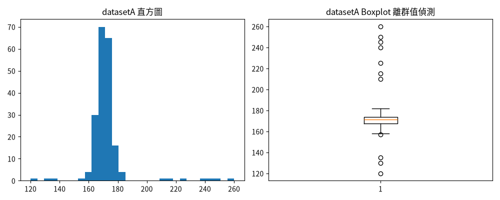
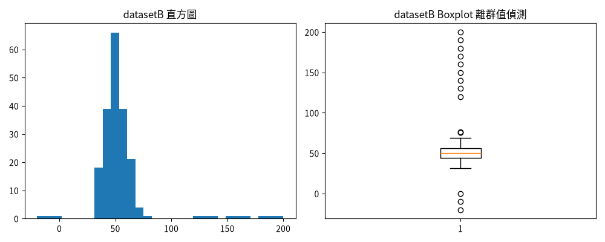
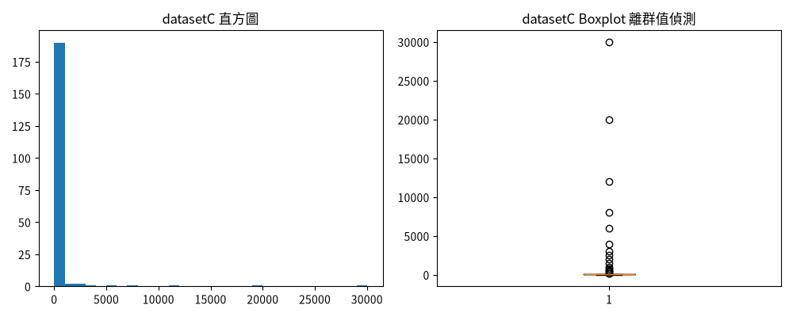
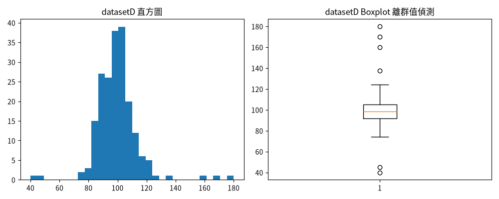
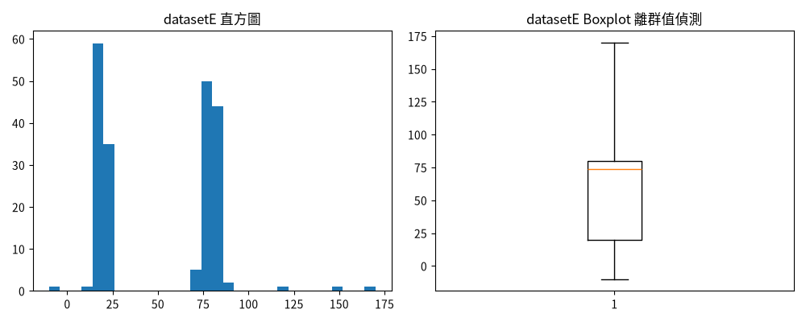

# 大數據應用 Week 9：資料清理 — 離群值偵測

## 練習題目

> 哪些 dataset 適合用 Z-score、哪些適合用 IQR、哪些都可以？

- **Z-score**：$z=(x-\mu)/\sigma$，|z| > 3 判為離群值。前提是資料接近常態、左右對稱；平均數與標準差會被極端值拉大，極端值多時反而會「遮蔽」其他離群值。
- **IQR**：低於 $Q1-1.5\times IQR$ 或高於 $Q3+1.5\times IQR$ 判為離群值。以分位數為基礎，對偏態、厚尾資料較穩健。

## 檔案列表

```
week9/
├── README.md              本說明
├── week9_outliers.py      分析腳本（可直接執行）
├── week9_outliers.ipynb   同內容的筆記本（中文說明 + 程式，已執行含輸出）
├── summary.csv            五個 dataset 的統計量與離群值數量
├── data/
│   └── datasetA.csv ~ datasetE.csv   原始資料（欄位 value，各 200 筆）
└── figures/
    └── datasetA.png ~ datasetE.png   直方圖 + Boxplot
```

## 執行方式

```bash
pip install pandas numpy matplotlib scipy        # 若尚未安裝
python3 week9_outliers.py                        # 產生 figures/*.png 與 summary.csv

# 或執行筆記本（輸出寫回同一檔案）
jupyter nbconvert --to notebook --execute --inplace week9_outliers.ipynb
```

## 計算結果（摘自 summary.csv）

| dataset | n | mean | median | std | skew | kurtosis | shapiro_p | IQR | Z-score 離群值數 | IQR 離群值數 |
|---|---|---|---|---|---|---|---|---|---|---|
| A | 200 | 172.1742 | 171.1242 | 14.1482 | 3.2425 | 18.3984 | 0.0 | 6.2715 | 7 | 11 |
| B | 200 | 54.4109 | 50.3407 | 26.1304 | 3.2212 | 14.0329 | 0.0 | 11.7316 | 7 | 14 |
| C | 200 | 512.4116 | 51.8239 | 2767.7467 | 8.2996 | 75.5559 | 0.0 | 40.5915 | 3 | 17 |
| D | 200 | 99.4787 | 98.471 | 14.3144 | 1.3271 | 9.9136 | 0.0 | 13.4002 | 5 | 6 |
| E | 200 | 51.7399 | 73.7077 | 32.5366 | 0.2617 | -0.7789 | 0.0 | 60.4114 | 2 | 0 |

> shapiro_p 在 summary.csv 中四捨五入到小數 4 位後皆為 0.0（實際值介於 1e-13 到 1e-29 之間），代表五組資料**含離群值的整體**都不服從常態，所以下面的判斷主要看直方圖形狀、偏態、std 與 IQR 的關係，以及兩種方法實際抓到哪些值。

## 各 dataset 判斷

### datasetA → 適合 IQR



- 直方圖主體集中在 160–185、左右對稱，但兩側各散落幾個極端值（120–135、210–260）。
- skew = 3.24、kurtosis = 18.40，厚尾明顯；std = 14.15 是 IQR = 6.27 的兩倍多，標準差被極端值撐大。
- 結果：Z-score 只抓到 7 個（120、215、225、240、245、250、260），**漏掉 130、135、210**（例如 130 的 z ≈ −2.98，剛好沒過 3）；IQR 抓到 11 個，Boxplot 上兩側的點都被標出。

### datasetB → 適合 IQR



- 主體集中在 30–75 的鐘形，但上方有一串 120–200、下方有 −20、−10、0。
- skew = 3.22、kurtosis = 14.03；std = 26.13 遠大於 IQR = 11.73，mean 54.41 被拉離 median 50.34。
- 結果：Z-score 只抓到上方 140–200 的 7 個，**下方 −20、−10、0 與 120、130 全被漏掉**（被膨脹的 std 遮蔽）；IQR 抓到 14 個，兩側都有涵蓋。

### datasetC → 適合 IQR（Z-score 不適合）



- 嚴重右偏：直方圖幾乎全部擠在 0 附近，長尾一路延伸到 30000。
- skew = 8.30、kurtosis = 75.56 為五組最大；std = 2767.75 是 mean 512.41 的 5 倍以上，mean 也比 median 51.82 大近 10 倍——平均數與標準差在這裡已失去代表性。
- 結果：Z-score 只抓到 12000、20000、30000 三個，400–8000 的極端值全被遮蔽；IQR 抓到 17 個。（注意 IQR 也標出 141.52、153.98，屬於長尾邊緣，實務上可再搭配領域知識或對數轉換確認。）

### datasetD → 兩者都可以



- 直方圖主體是單峰、大致對稱的鐘形（約 75–125），只在兩端各有少數明顯的極端值（40、45 與 160、170、180）。
- skew = 1.33 是有離群值的四組（A–D）中最小；std = 14.31 與 IQR = 13.40 相近，表示標準差沒有被極端值大幅撐大；mean 99.48 與 median 98.47 幾乎相同。
- 結果：Z-score 5 個、IQR 6 個，**Z-score 抓到的 5 個 IQR 全部也有抓到**，唯一差別是 137.52（z ≈ 2.69）。兩種方法結論幾乎一致。

### datasetE → 兩者都不理想（雙峰資料）；Z-score 略好，但最好先分群



- 直方圖是**雙峰**：一群在 15–25、一群在 70–90，另外有 −10、120、150、170 幾個零星值。
- skew = 0.26、kurtosis = −0.78 看起來「很對稱、不厚尾」，但這是雙峰造成的假象；mean 51.74 落在兩峰之間的空白區（那裡幾乎沒有資料），median 73.71 落在右峰。
- IQR = 60.41 很大，因為 Q1（19.54）與 Q3（79.96）分別落在兩個峰裡，圍欄被撐到涵蓋所有資料 → **IQR 抓到 0 個**，Boxplot 上也沒有任何點。
- std = 32.54 同樣被兩峰的距離撐大 → Z-score 只抓到 150、170 兩個，−10 與 120 被遮蔽。
- 結論：單看數字 Z-score 抓到的較多，但兩種方法都假設資料只有一個中心，雙峰時都會失準；應先把兩群分開再各自做偵測。

## 總結

| dataset | 分佈特徵（依數據與圖） | 建議 |
|---|---|---|
| A | 單峰對稱主體 + 兩側極端值，厚尾（kurtosis 18.40） | IQR |
| B | 單峰主體 + 上下兩側極端值，std 是 IQR 的 2 倍以上 | IQR |
| C | 嚴重右偏長尾（skew 8.30），std > mean | IQR |
| D | 單峰近對稱，std ≈ IQR，兩法結果 5 vs 6 幾乎一致 | 都可以 |
| E | 雙峰，IQR 抓 0 個、Z 抓 2 個 | 都不理想，先分群 |

- **沒有任何一組是「只適合 Z-score」**：五組的 Shapiro p 值都趨近 0，而且 A、B、C 中 Z-score 都因 std 被極端值撐大而漏抓。
- Z-score 最大的弱點就是 **masking（遮蔽）**：離群值越多、越極端，std 越大，|z| 越難超過 3。
